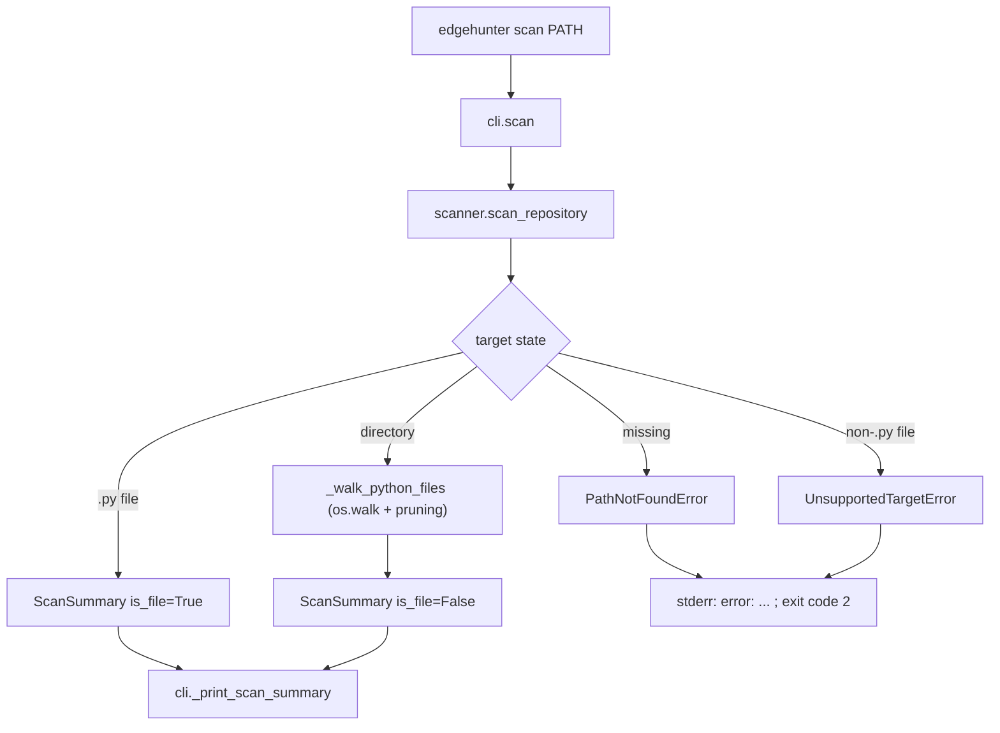

# EdgeHunter — System Flow

This file describes how data moves through the code that exists today. It is
updated whenever entry points, call order, stored data, or error paths change.
Only implemented behavior is described; future subsystems are not listed here.

---

## 1. Entry points

EdgeHunter is a library with a command-line front end.

```text
console script:  edgehunter             -> edgehunter.cli:main()      (pyproject [project.scripts])
module:          python -m edgehunter   -> edgehunter.__main__ -> edgehunter.cli.main()
in-process:      typer.testing.CliRunner -> the typer.Typer application (used by tests)
```

`main()` in `src/edgehunter/cli.py` calls the `typer.Typer` application
(`app`), which performs argument parsing and dispatch.

## 2. Command tree

```text
edgehunter
├── --version   (eager option on the root callback `_root_callback`)
└── scan PATH   (command `scan`)
```

## 3. Flow: `edgehunter --version`

```text
app()                                          src/edgehunter/cli.py  — Typer application entry
 └─ _root_callback()                           src/edgehunter/cli.py  — group callback runs first
     └─ _version_callback(True)                src/edgehunter/cli.py  — eager option callback
         ├─ typer.echo("edgehunter 0.1.0")     prints version from edgehunter.__version__
         └─ raise typer.Exit()                 exits with code 0 before any command runs
```

Why: `is_eager=True` makes `--version` run before command resolution, so it
works even when no command is given.

## 4. Flow: `edgehunter scan PATH`

Where the data comes from: the `PATH` argument typed by the user (a directory
or a single Python file). Nothing is read from the network or environment, and
no target code is imported or executed.

```text
app()                                          src/edgehunter/cli.py — Typer application entry
 └─ scan(path)                                 src/edgehunter/cli.py — command entry, PATH parsed as pathlib.Path
     ├─ scan_repository(target)                src/edgehunter/scanner/repository.py — library entry
     │   ├─ _resolve_target(target)            canonicalizes input: expanduser() then resolve(strict=True)
     │   │   └─ raises PathNotFoundError       when the path does not exist
     │   │   └─ raises ScanError               when the path cannot be resolved (OSError/RuntimeError)
     │   ├─ resolved.is_file()                 single-file target
     │   │   ├─ rejects non-*.py with UnsupportedTargetError
     │   │   └─ returns ScanSummary(is_file=True, python_files=(file,))
     │   └─ _walk_python_files(resolved)       directory target: os.walk (followlinks=False)
     │       ├─ is_excluded_directory(name)    checks EXCLUDED_DIRECTORY_NAMES and ".egg-info" suffix
     │       ├─ dirnames[:] = kept             prunes excluded subtrees in place
     │       └─ collects *.py files, sorted    returns (python_files, excluded_directories) tuples
     └─ _print_scan_summary(summary)           src/edgehunter/cli.py — prints counts + "not implemented" note
```

Where the data ends up: stdout (summary text). Nothing is written to disk and
no state is kept between invocations.

Error path: on `ScanError`, the CLI prints `error: <message>` to stderr and
exits with code 2 (`EXIT_INVALID_INPUT`). Unexpected exceptions propagate
unchanged (traceback, non-zero exit) because they indicate bugs.

Why it works this way: discovery is isolated in the `scanner` package so the
CLI stays a thin presentation layer, and the scanner never imports or executes
target code, keeping the unsafe-execution boundary clean for a later phase.

## 5. Discovery rules (policy, `src/edgehunter/scanner/repository.py`)

- Include: files whose name ends in `.py` (exact case).
- Prune: directories named `.eggs`, `.git`, `.hg`, `.hypothesis`, `.mypy_cache`, `.nox`, `.pytest_cache`, `.ruff_cache`, `.svn`, `.tox`, `.venv`, `__pycache__`, `build`, `dist`, `env`, `node_modules`, `site-packages`, `venv`, `virtualenv`, and any directory whose name ends in `.egg-info`.
- Do not follow symlinks (`os.walk` default `followlinks=False`).
- Visit names in sorted order so results are deterministic.

## 6. Diagram



## Changes in this session (Phase 0: Repository Bootstrap and Engineering Foundation)

| Area | Change | Files | Commit | Decision |
|---|---|---|---|---|
| packaging | Created `pyproject.toml` (setuptools backend, dynamic version, console script, dev extra, tool config) | pyproject.toml | ac9b228 | D-001, D-002, D-006 |
| package | Created `src/edgehunter/` package with `__init__.py` (literal `__version__ = "0.1.0"`) and `__main__.py` | src/edgehunter/__init__.py, src/edgehunter/__main__.py | ac9b228 | D-001, D-002 |
| CLI | Added Typer application with `--version` callback and `scan PATH` command; invalid input exits with code 2 | src/edgehunter/cli.py | ac9b228 | D-003, D-005 |
| scanner | Added filesystem discovery (`scan_repository`, `ScanSummary`, `ScanError` hierarchy, exclusion policy) | src/edgehunter/scanner/repository.py, src/edgehunter/scanner/__init__.py | ac9b228 | D-004 |
| tests | Added CLI tests (in-process + one subprocess entry-point test) and scanner tests | tests/test_cli.py, tests/test_repository_scanner.py | ac9b228 | D-007 |
| docs | Created `decisions.md`, `flow.md`, `.gitignore`, `README.md` | decisions.md, flow.md, .gitignore, README.md | ac9b228 | none |
| docs | Recorded real commit hashes in `decisions.md`/`flow.md`, added `handoff.md`, added D-008 (typer.testing-only imports) | decisions.md, flow.md, handoff.md | c729a70 | D-008 |
