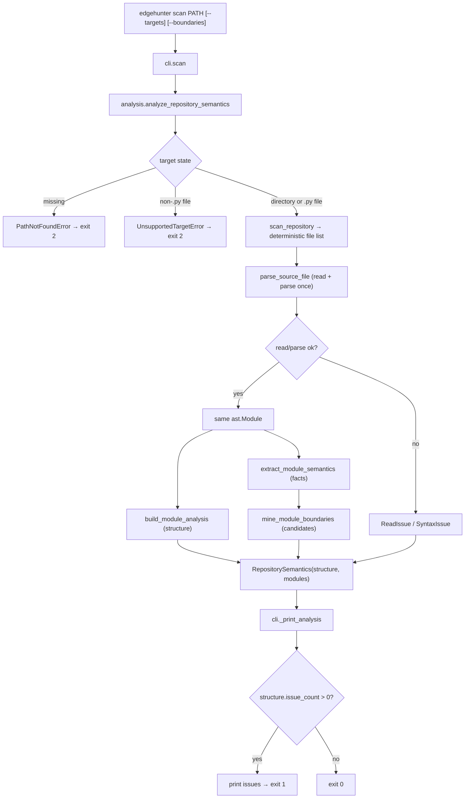

# EdgeHunter — System Flow

This file describes how data moves through the code that exists today. It is
updated whenever entry points, call order, stored data, or error paths change.
Only implemented behavior is described; future subsystems are not listed here.

---

## 1. Entry points

EdgeHunter is a library with a command-line front end.

```text
console script:  edgehunter             -> edgehunter.cli:main()      (pyproject [project.scripts])
module:          python -m edgehunter   -> edgehunter.__main__ -> edgehunter.cli.main()
in-process:      typer.testing.CliRunner -> the typer.Typer application (used by tests)
```

`main()` in `src/edgehunter/cli.py` calls the `typer.Typer` application
(`app`), which performs argument parsing and dispatch.

## 2. Command tree

```text
edgehunter
├── --version                        (eager option on the root callback `_root_callback`)
└── scan PATH [--targets] [--boundaries]   (command `scan`)
```

## 3. Flow: `edgehunter --version`

```text
app()                                          src/edgehunter/cli.py  — Typer application entry
 └─ _root_callback()                           src/edgehunter/cli.py  — group callback runs first
     └─ _version_callback(True)                src/edgehunter/cli.py  — eager option callback
         ├─ typer.echo("edgehunter 0.1.0")     prints version from edgehunter.__version__
         └─ raise typer.Exit()                 exits with code 0 before any command runs
```

Why: `is_eager=True` makes `--version` run before command resolution, so it
works even when no command is given.

## 4. Flow: `edgehunter scan PATH [--targets] [--boundaries]`

Where the data comes from: the `PATH` argument typed by the user (a directory
or a single Python file) plus the optional detail flags. Nothing is read from
the network or environment, and no target code is imported or executed.

```text
app()                                          src/edgehunter/cli.py — Typer application entry
 └─ scan(path, targets, boundaries)            src/edgehunter/cli.py — command entry; PATH parsed as pathlib.Path
     ├─ analyze_repository_semantics(target)   src/edgehunter/analysis/repository.py — library entry; reads and parses each file once
     │   ├─ scan_repository(target)            src/edgehunter/scanner/repository.py — discovery (section 5)
     │   ├─ parse_source_file(path, rel)       src/edgehunter/scanner/ast_parser.py — read + parse ONCE per file
     │   │   └─ _read_source(path)             tokenize.open → PEP 263 encoding rules
     │   │       └─ OSError/SyntaxError/UnicodeDecodeError → ReadIssue
     │   │   └─ ast.parse(source)              SyntaxError → SyntaxIssue
     │   │       └─ returns SourceFile(tree | None)
     │   ├─ build_module_analysis(source)      src/edgehunter/scanner/ast_parser.py — structural facts from the same AST
     │   │   └─ extract_module_targets(tree)   src/edgehunter/scanner/targets.py
     │   │       ├─ _build_function(...)       parameters, annotations, decorators, owner, qualified name
     │   │       └─ _build_class(...)          bases, decorators, qualified name
     │   └─ extract_module_semantics(source, module)
     │       │                                 src/edgehunter/analysis/semantics.py
     │       ├─ collect_callable_nodes(tree)   src/edgehunter/scanner/targets.py — same qualified names as structure
     │       ├─ _target_semantics(item)        per callable: predicates, comparisons, constants, arithmetic
     │       └─ mine_module_boundaries(module, targets)
     │                                         src/edgehunter/analysis/boundaries.py — candidates per target
     └─ _print_analysis(analysis, show_targets=..., show_boundaries=...)
         ├─ structural counts                 read from analysis.structure (Phase 1 statistics)
         ├─ semantic counts                   Predicates / Comparisons / Arithmetic expressions / Boundary candidates
         ├─ _print_issues(structure)           Syntax issues and Read issues sections when present
         ├─ _print_targets(structure)          only with --targets
         └─ _print_boundaries(analysis)       only with --boundaries; grouped by parameter
```

Where the data ends up: stdout (statistics, issues, optional target and
boundary listings). Nothing is written to disk and no state is kept between
invocations.

Error behavior: `ScanError` (missing path, unsupported target) prints
`error: <message>` to stderr and exits 2 (`EXIT_INVALID_INPUT`). A scan that
completes but finds unreadable or unparseable files prints the issues and
exits 1 (`EXIT_SCAN_ISSUES`). A clean scan exits 0. Unexpected exceptions
propagate unchanged (traceback, non-zero exit) because they indicate bugs; a
bug inside semantic analysis is never converted into a "source issue".

Why it works this way: one read/parse per file feeds both extractors, so the
structural and semantic views of a file cannot disagree. Discovery stays in
`scan_repository()`, file analysis stays in `scanner`, semantics and boundary
mining live in `analysis`, and the CLI only formats results.

## 5. Discovery rules (policy, `src/edgehunter/scanner/repository.py`)

- Include: files whose name ends in `.py` (exact case).
- Prune: directories named `.eggs`, `.git`, `.hg`, `.hypothesis`, `.mypy_cache`, `.nox`, `.pytest_cache`, `.ruff_cache`, `.svn`, `.tox`, `.venv`, `__pycache__`, `build`, `dist`, `env`, `node_modules`, `site-packages`, `venv`, `virtualenv`, and any directory whose name ends in `.egg-info`.
- Do not follow symlinks (`os.walk` default `followlinks=False`).
- Visit names in sorted order so results are deterministic.

## 6. Analysis rules (src/edgehunter/scanner/ast_parser.py, targets.py, models.py)

- Reading: `tokenize.open` (BOM and PEP 263 coding cookies). Failures become `ReadIssue`.
- Parsing: `ast.parse` only; no imports, `eval`, `exec`, or subprocess of any kind.
- Target kinds: immediate lexical scope decides method vs nested function vs function; `async def` selects the async variant. Compound statements (`if`/`try`/loops/`with`/`match`) do not change scope.
- Qualified names: dotted lexical path within the file (`Outer.Inner.run`, `outer.inner`); no package resolution yet.
- Ordering: files in discovery order (a directory's files before its subdirectories, each sorted); functions and classes within a module sorted by `(lineno, qualified_name)`.
- Annotations, decorators, and bases are stored as `ast.unparse` output (source text); defaults are recorded only as `has_default`.
- Issues: at most one `SyntaxIssue` (line/column/message from `SyntaxError`) or `ReadIssue` (exception message) per file; analysis of other files continues.

## 7. Semantic fact rules (src/edgehunter/analysis/semantics.py)

- Predicates come from `if`, `while`, and `assert` only; `elif` yields its own predicate.
- Each predicate keeps its containing expression plus every comparison inside it, including inside `and`/`or` operands.
- Chained comparisons are decomposed into adjacent pairs (`0 < x <= 10` gives `0 < x` and `x <= 10`).
- Comparisons only originate inside predicates; operators map to a stable `ComparisonOperator` enum.
- Constants are recorded per literal occurrence with `bool` classified before `int`; `...` is not recorded; signed numerics (`-1`) come from an explicit `UnaryOp`-over-`Constant` helper, never `eval`/`literal_eval`.
- Arithmetic is recorded as maximal subexpressions only (`(x + y) * 2` is one record with both operators), with a context of return / assignment / annotated assignment / augmented assignment / expression. No folding or simplification.
- Traversal stops at nested `FunctionDef`, `AsyncFunctionDef`, `ClassDef`, and `Lambda`, so inner callables never donate facts to their parent; module- and class-level conditions belong to no target.
- A file that failed to read or parse contributes no facts; its `ReadIssue`/`SyntaxIssue` is the only report.
- Expressions are rendered with `render_source()`; `ExpressionInfo.simple` marks literals, bare names, and plain dotted chains as stable references.

## 8. Boundary mining rules (src/edgehunter/analysis/boundaries.py)

- Candidates are mined only for declared parameters; one side of a comparison must be a bare parameter name.
- If the parameter is on the right, the operator is inverted (`<`->`>`, `<=`->`>=`, `>`->`<`, `>=`->`<=`, `==`->`==`, `!=`->`!=`); `is`, `is not`, `in`, `not in` are never inverted.
- Both sides parameters: the syntactic left side wins, so no inverse relational candidate is emitted.
- References stay symbolic (`amount` at `balance`, never `balance - 1`).
- A reference must be a literal, bare name, or plain dotted name chain; calls, subscripts, and complex expressions are skipped while the comparison is still recorded.
- Inequality with an ordered reference gives `JUST_BELOW`/`AT_BOUNDARY`/`JUST_ABOVE`; `==`/`!=` give `AT_BOUNDARY` only; `is`/`in` give nothing; a non-numeric literal gives `AT_BOUNDARY` only.
- Generic numeric candidates require an annotation of exactly `int` (zero, one, negative one) or `float` (plus negative zero, NaN, +Infinity, -Infinity) on a positional-only, positional-or-keyword, or keyword-only parameter.
- Deduplicated by `(parameter, kind, reference)` per target, keeping every evidence line; ordered by `(parameter, kind rank, reference)`.
- No candidate is a bug claim: language is "candidate", "boundary", "interesting region", "static evidence".

## 9. Diagram



## Changes in this session (Phase 0: Repository Bootstrap and Engineering Foundation)

| Area | Change | Files | Commit | Decision |
|---|---|---|---|---|
| packaging | Created `pyproject.toml` (setuptools backend, dynamic version, console script, dev extra, tool config) | pyproject.toml | ac9b228 | D-001, D-002, D-006 |
| package | Created `src/edgehunter/` package with `__init__.py` (literal `__version__ = "0.1.0"`) and `__main__.py` | src/edgehunter/__init__.py, src/edgehunter/__main__.py | ac9b228 | D-001, D-002 |
| CLI | Added Typer application with `--version` callback and `scan PATH` command; invalid input exits with code 2 | src/edgehunter/cli.py | ac9b228 | D-003, D-005 |
| scanner | Added filesystem discovery (`scan_repository`, `ScanSummary`, `ScanError` hierarchy, exclusion policy) | src/edgehunter/scanner/repository.py, src/edgehunter/scanner/__init__.py | ac9b228 | D-004 |
| tests | Added CLI tests (in-process + one subprocess entry-point test) and scanner tests | tests/test_cli.py, tests/test_repository_scanner.py | ac9b228 | D-007 |
| docs | Created `decisions.md`, `flow.md`, `.gitignore`, `README.md` | decisions.md, flow.md, .gitignore, README.md | ac9b228 | none |
| docs | Recorded real commit hashes in `decisions.md`/`flow.md`, added `handoff.md`, added D-008 (typer.testing-only imports) | decisions.md, flow.md, handoff.md | c729a70 | D-008 |

## Changes in this session (Phase 1 — Repository Scanner + Safe AST Extraction)

| Area | Change | Files | Commit | Decision |
|---|---|---|---|---|
| scanner | Added immutable AST models (ParameterInfo, FunctionInfo, ClassInfo, ModuleAnalysis, SyntaxIssue, ReadIssue, kinds) | src/edgehunter/scanner/models.py | 82d42f3 | D-009, D-010, D-012 |
| scanner | Added scope-aware target extraction with qualified names, parameter kinds, annotations, decorators, line spans | src/edgehunter/scanner/targets.py | 82d42f3 | D-010 |
| scanner | Added safe file analysis: `tokenize.open` reading, `ast.parse`, structured issues | src/edgehunter/scanner/ast_parser.py | 82d42f3 | D-011, D-012, D-014 |
| scanner | Added `RepositoryAnalysis` and `analyze_repository()`; `ScanSummary`/`scan_repository()` unchanged | src/edgehunter/scanner/repository.py, src/edgehunter/scanner/__init__.py | 82d42f3 | D-009 |
| CLI | `scan` prints AST statistics and issue sections, supports `--targets`, exits 1 when issues exist | src/edgehunter/cli.py | 82d42f3 | D-013 |
| tests | Parser, safety, and aggregation tests; CLI tests updated for new output and exit codes | tests/test_ast_parser.py, tests/test_safety.py, tests/test_repository_analysis.py, tests/test_cli.py | 82d42f3 | D-010..D-014 |
| docs | Added decisions D-009..D-014 and updated this flow document | decisions.md, flow.md | 82d42f3 | none |
| docs | Recorded Phase 1 commit hash in `decisions.md`/`flow.md`, rewrote `handoff.md` | decisions.md, flow.md, handoff.md | 603b709 | none |

## Changes in this session (Phase 2 — Static Semantic Analysis + Boundary Mining)

| Area | Change | Files | Commit | Decision |
|---|---|---|---|---|
| scanner | Split the pipeline so each file is read/parsed once: added `SourceFile`, `parse_source_file()`, `build_module_analysis()`, `CallableNode`, `collect_callable_nodes()`, and shared `scanner/rendering.py` | src/edgehunter/scanner/ast_parser.py, src/edgehunter/scanner/targets.py, src/edgehunter/scanner/rendering.py, src/edgehunter/scanner/__init__.py | b538557 | D-015 |
| analysis | Added the `analysis` package with immutable semantic and boundary models | src/edgehunter/analysis/__init__.py, src/edgehunter/analysis/models.py | b538557 | D-016, D-017 |
| analysis | Added predicate/comparison/constant/arithmetic extraction (if, while, assert; chained decomposition; bool kept out of numeric) | src/edgehunter/analysis/semantics.py | b538557 | D-016, D-020 |
| analysis | Added deterministic boundary mining with symbolic references, safe-reference rule, dedup, and ordering | src/edgehunter/analysis/boundaries.py | b538557 | D-017, D-018 |
| analysis | Added repository orchestration `analyze_repository_semantics()` returning structure plus semantics | src/edgehunter/analysis/repository.py | b538557 | D-015 |
| CLI | `scan` prints semantic statistics, gained `--boundaries`; exit codes unchanged | src/edgehunter/cli.py | b538557 | D-019 |
| tests | Added semantic extraction, boundary mining, repository aggregation, semantic no-execution, and CLI tests | tests/test_semantics.py, tests/test_boundaries.py, tests/test_semantic_repository.py, tests/test_safety.py, tests/test_cli.py | b538557 | D-016..D-020 |
| docs | Added decisions D-015..D-020 and updated this flow document | decisions.md, flow.md | b538557 | none |
