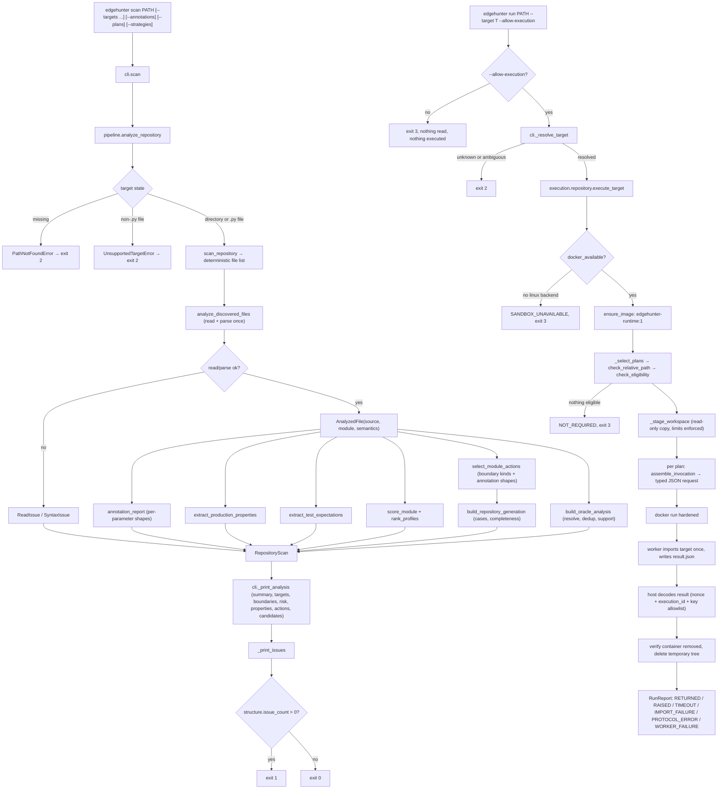

# EdgeHunter — System Flow

This file describes how data moves through the code that exists today. It is
updated whenever entry points, call order, stored data, or error paths change.
Only implemented behavior is described; future subsystems are not listed here.

---

## 1. Entry points

EdgeHunter is a library with a command-line front end.

```text
console script:  edgehunter             -> edgehunter.cli:main()      (pyproject [project.scripts])
module:          python -m edgehunter   -> edgehunter.__main__ -> edgehunter.cli.main()
in-process:      typer.testing.CliRunner -> the typer.Typer application (used by tests)
```

`main()` in `src/edgehunter/cli.py` calls the `typer.Typer` application
(`app`), which performs argument parsing and dispatch.

## 2. Command tree

```text
edgehunter
├── --version                        (eager option on the root callback `_root_callback`)
├── scan PATH [--targets] [--boundaries] [--risk] [--properties] [--actions] [--candidates]
│             [--annotations] [--plans] [--strategies]        (command `scan`)
└── run PATH --target NAME [--allow-execution] [--max-cases N] [--timeout S]
                                                       (command `run`)
```

`scan` is static only and never executes target code. `run` is the only command
that starts a container, and it requires an explicit target plus opt-in.

## 3. Flow: `edgehunter --version`

```text
app()                                          src/edgehunter/cli.py  — Typer application entry
 └─ _root_callback()                           src/edgehunter/cli.py  — group callback runs first
     └─ _version_callback(True)                src/edgehunter/cli.py  — eager option callback
         ├─ typer.echo("edgehunter 0.1.0")     prints version from edgehunter.__version__
         └─ raise typer.Exit()                 exits with code 0 before any command runs
```

Why: `is_eager=True` makes `--version` run before command resolution, so it
works even when no command is given.

## 4. Flow: `edgehunter scan PATH [--targets] ... [--annotations] [--plans] [--strategies]`

Where the data comes from: the `PATH` argument typed by the user (a directory
or a single Python file) plus the optional detail flags. Nothing is read from
the network or environment, and no target code is imported or executed.

```text
app()                                          src/edgehunter/cli.py — Typer application entry
 └─ scan(path, targets, boundaries, risk, properties, actions, candidates)
                                                 src/edgehunter/cli.py — command entry
     ├─ analyze_repository(target)             src/edgehunter/pipeline.py — composition root, ONE read+parse per file
     │   ├─ scan_repository(target)            src/edgehunter/scanner/repository.py — discovery (section 5)
     │   ├─ analyze_discovered_files(discovery)
     │   │                                     src/edgehunter/analysis/repository.py — per-file stage
     │   │   ├─ parse_source_file(path, rel)   src/edgehunter/scanner/ast_parser.py — read + parse ONCE
     │   │   │   └─ _read_source(path)         tokenize.open → PEP 263 encoding rules
     │   │   │       └─ OSError/SyntaxError/UnicodeDecodeError → ReadIssue
     │   │   │   └─ ast.parse(source)          SyntaxError → SyntaxIssue → SourceFile(tree | None)
     │   │   ├─ build_module_analysis(source)  structural facts from the same AST
     │   │   │   └─ extract_module_targets(tree)  src/edgehunter/scanner/targets.py
     │   │   └─ extract_module_semantics(source, module)
     │   │       └─ mine_module_boundaries(module, targets)  src/edgehunter/analysis/boundaries.py
     │   │   → AnalyzedFile(source, module, semantics)
     │   ├─ extract_production_properties(source, semantics)
     │   │                                     src/edgehunter/oracle/production.py — asserts + if/raise guards
     │   ├─ extract_test_expectations(source)   src/edgehunter/oracle/test_expectations.py — test files only
     │   ├─ score_module(module, semantics)     src/edgehunter/analysis/risk.py — per-target profile
     │   ├─ rank_profiles(profiles)              deterministic ordering
     │   ├─ select_module_actions(module, semantics)
     │   │                                     src/edgehunter/generation/actions.py — applicable actions per target
     │   ├─ build_oracle_analysis(production, expectations, modules)
     │   │                                     src/edgehunter/oracle/repository.py — dedup, resolution, support
     │   ├─ build_repository_generation(action_sets)
     │   │                                     src/edgehunter/generation/repository.py — single-action cases
     │   ├─ build_repository_planning(generation, modules, observed_literals)
     │   │                                     src/edgehunter/generation/planning.py — invocation plans
     │   │       ├─ plan_case(case, function, literals)
     │   │       │                             src/edgehunter/generation/invocation.py — baselines, placement, status
     │   │       │   └─ baseline_for(shape)     src/edgehunter/generation/baselines.py — trustworthy fillers
     │   │       └─ plan_strategies(path, function, actions)
     │   │                                     src/edgehunter/generation/strategy.py — deterministic plans
     │   └─ annotation_report(modules)         src/edgehunter/generation/planning.py — per-parameter shapes
     └─ _print_analysis(...)
         ├─ structural + semantic counts       from analysis.semantics
         ├─ _print_oracle_counts(...)           Oracle evidence block
         ├─ _print_generation_counts(...)       Semantic actions block
         ├─ _print_planning_counts(...)         Planning block
         ├─ _print_annotations(...)             only with --annotations
         ├─ _print_targets / _print_boundaries
         ├─ _print_risk(...)                   only with --risk
         ├─ _print_properties(...)             only with --properties
         ├─ _print_actions(...)                only with --actions
         ├─ _print_candidates(...)             only with --candidates
         ├─ _print_plans(...)                  only with --plans
         ├─ _print_strategies(...)             only with --strategies
         └─ _print_issues(structure)            source issues last
```

`generation.repository.build_repository_generation()` converts the per-target
action lists into the repository aggregate and into candidate cases; it runs
inside `analyze_repository()` alongside `build_oracle_analysis()`.

Where the data ends up: stdout (statistics, optional detail sections, source
issues). Nothing is written to disk and no state is kept between invocations.

Error behavior: `ScanError` (missing path, unsupported target) prints
`error: <message>` to stderr and exits 2 (`EXIT_INVALID_INPUT`). A scan that
completes but finds unreadable or unparseable files exits 1
(`EXIT_SCAN_ISSUES`). A clean scan exits 0. Oracle ambiguity, unresolved
expectations, symbolic actions, unsupported actions, unknown annotations, and
incomplete invocation plans never change the exit code: they are analysis
limitations, not malformed source. Unexpected exceptions
propagate unchanged because they indicate bugs.

Why it works this way: `pipeline.analyze_repository()` owns the single pass, so
structure, semantics, oracles, risk, actions, and plans all describe the same
bytes and cost one read and one parse per file. Annotation shapes are built from
the `ast.arg` annotation node the scanner already holds, so interpreting an
annotation introduces no second parse. `analysis.repository.analyze_repository_semantics()`
remains available as the Phase 2 entry point and is built from the same
per-file helper.

## 5. Discovery rules (policy, `src/edgehunter/scanner/repository.py`)

- Include: files whose name ends in `.py` (exact case).
- Prune: directories named `.eggs`, `.git`, `.hg`, `.hypothesis`, `.mypy_cache`, `.nox`, `.pytest_cache`, `.ruff_cache`, `.svn`, `.tox`, `.venv`, `__pycache__`, `build`, `dist`, `env`, `node_modules`, `site-packages`, `venv`, `virtualenv`, and any directory whose name ends in `.egg-info`.
- Do not follow symlinks (`os.walk` default `followlinks=False`).
- Visit names in sorted order so results are deterministic.

## 6. Analysis rules (src/edgehunter/scanner/ast_parser.py, targets.py, models.py)

- Reading: `tokenize.open` (BOM and PEP 263 coding cookies). Failures become `ReadIssue`.
- Parsing: `ast.parse` only; no imports, `eval`, `exec`, or subprocess of any kind.
- Target kinds: immediate lexical scope decides method vs nested function vs function; `async def` selects the async variant. Compound statements (`if`/`try`/loops/`with`/`match`) do not change scope.
- Qualified names: dotted lexical path within the file (`Outer.Inner.run`, `outer.inner`); no package resolution yet.
- Ordering: files in discovery order (a directory's files before its subdirectories, each sorted); functions and classes within a module sorted by `(lineno, qualified_name)`.
- Annotations, decorators, and bases are stored as `ast.unparse` output (source text); defaults are recorded only as `has_default`.
- Issues: at most one `SyntaxIssue` (line/column/message from `SyntaxError`) or `ReadIssue` (exception message) per file; analysis of other files continues.

## 7. Semantic fact rules (src/edgehunter/analysis/semantics.py)

- Predicates come from `if`, `while`, and `assert` only; `elif` yields its own predicate.
- Each predicate keeps its containing expression plus every comparison inside it, including inside `and`/`or` operands.
- Chained comparisons are decomposed into adjacent pairs (`0 < x <= 10` gives `0 < x` and `x <= 10`).
- Comparisons only originate inside predicates; operators map to a stable `ComparisonOperator` enum.
- Constants are recorded per literal occurrence with `bool` classified before `int`; `...` is not recorded; signed numerics (`-1`) come from an explicit `UnaryOp`-over-`Constant` helper, never `eval`/`literal_eval`.
- Arithmetic is recorded as maximal subexpressions only (`(x + y) * 2` is one record with both operators), with a context of return / assignment / annotated assignment / augmented assignment / expression. No folding or simplification.
- Traversal stops at nested `FunctionDef`, `AsyncFunctionDef`, `ClassDef`, and `Lambda`, so inner callables never donate facts to their parent; module- and class-level conditions belong to no target.
- A file that failed to read or parse contributes no facts; its `ReadIssue`/`SyntaxIssue` is the only report.
- Expressions are rendered with `render_source()`; `ExpressionInfo.simple` marks literals, bare names, and plain dotted chains as stable references.

## 8. Boundary mining rules (src/edgehunter/analysis/boundaries.py)

- Candidates are mined only for declared parameters; one side of a comparison must be a bare parameter name.
- If the parameter is on the right, the operator is inverted (`<`->`>`, `<=`->`>=`, `>`->`<`, `>=`->`<=`, `==`->`==`, `!=`->`!=`); `is`, `is not`, `in`, `not in` are never inverted.
- Both sides parameters: the syntactic left side wins, so no inverse relational candidate is emitted.
- References stay symbolic (`amount` at `balance`, never `balance - 1`).
- A reference must be a literal, bare name, or plain dotted name chain; calls, subscripts, and complex expressions are skipped while the comparison is still recorded.
- Inequality with an ordered reference gives `JUST_BELOW`/`AT_BOUNDARY`/`JUST_ABOVE`; `==`/`!=` give `AT_BOUNDARY` only; `is`/`in` give nothing; a non-numeric literal gives `AT_BOUNDARY` only.
- Generic numeric candidates require an annotation of exactly `int` (zero, one, negative one) or `float` (plus negative zero, NaN, +Infinity, -Infinity) on a positional-only, positional-or-keyword, or keyword-only parameter.
- Deduplicated by `(parameter, kind, reference)` per target, keeping every evidence line; ordered by `(parameter, kind rank, reference)`.
- No candidate is a bug claim: language is "candidate", "boundary", "interesting region", "static evidence".

## 9. Structural risk rules (src/edgehunter/analysis/risk.py)

- A search-priority heuristic, explicitly not a probability or bug estimate; total capped at 100.
- Contributions and caps: predicates +6 each (cap 30), arithmetic +4 each (cap 20), boundary groups +4 each (cap 20), input parameters +3 each (cap 15), source span +3 per started block of 20 lines (cap 15).
- A boundary group is a unique `(parameter, reference)` pair, so below/at/above for one reference count once and a float's generic numeric values count once.
- Source span uses the scanner's `lineno`/`end_lineno`, falling back to a single line; no source is re-read.
- A method's first `self`/`cls` parameter is not counted as user input.
- Ranking: score descending, then relative POSIX path, then line, then qualified name.
- Risk is independent of oracle support; neither is derived from the other.

## 10. Oracle mining rules (src/edgehunter/oracle/)

- Strength is categorical (`strong`), never a numeric confidence; no calibration exists.
- Production: `assert` predicates (reusing Phase 2 facts) plus the literal/rendered message, and `if COND: raise EXC` guards whose body is exactly one `raise`.
- Exception syntax: bare name, convention-suffixed name call (`Error`/`Exception`/`Warning`), or dotted call; anything else records no exception type.
- Test files (`test_*.py`, `*_test.py`) are excluded from production mining; their asserts are mined as expectations.
- Expectations: `assert <call> <op> <expected>` (reversed form normalized only for safely invertible operators) and `with pytest.raises(X):` with a single direct call body.
- Resolution: unique bare name → resolved; several → ambiguous; none → unresolved; dotted or chained receiver calls always unresolved. Unresolved evidence is retained, never discarded.
- Properties are deduplicated per module and across the repository, keeping every evidence line sorted.

## 11. Generation rules (src/edgehunter/generation/)

- The action vocabulary is closed: `SemanticActionKind` has fourteen members and `BOUNDARY_ACTIONS` maps all ten `BoundaryKind` values one-to-one onto ten of them. The other four (`SET_NONE`, `EMPTY_COLLECTION`, `SINGLETON_COLLECTION`, `DUPLICATE_ELEMENT_COLLECTION`) are annotation-driven and have no boundary counterpart. Nothing else can be proposed.
- Every action records its origin: `BOUNDARY` (a mined candidate justified it) or `ANNOTATION` (the declared annotation did).
- Actions are selected per parameter, deduplicated by `(parameter, kind, reference)`, and ordered by `(parameter, ACTION_KIND_ORDER, reference)`.
- Applicability for numeric actions comes from Phase 2's boundary candidates, whose annotation rule now reads the static shape: a nullable `int | None` is still an integer, and `bool` is still not numeric.
- Applicability for collection and nullability actions is decided from the static annotation shape (section 12), not from annotation text, so `list[int]`, `dict[str, int]`, and `int | None` are all recognized.
- Annotation-derived actions are restricted to single-value parameter buckets; `*args`/`**kwargs` never receive a generic action.
- Untyped parameters are not excluded: they still receive actions derived from their own comparisons.
- Materialization is `CONCRETE`, `SYMBOLIC`, or `UNSUPPORTED`. Integer literal references use exact neighbours (`9`/`10`/`11`); float references use `math.nextafter` and are rendered with `repr`; other literal kinds can be matched exactly but not stepped.
- A name or attribute reference stays symbolic: `AT_BOUNDARY` names it, and the below/above forms stay symbolic rather than inventing a neighbour.
- Stepping around a `complex` literal is `UNSUPPORTED`. Literal text is parsed with `int`/`float`, never `eval` or `ast.literal_eval`.
- Empty collections render as `[]`, `()`, `{}`, `set()` unconditionally, because an empty container needs no element knowledge. A singleton or repeated element renders only from a trustworthy element baseline (`[0]`, `("",)`, `{False}`, `{"": 0}`); an unknown element type is `UNSUPPORTED` with a reason, and no placeholder element is ever fabricated.
- A candidate case holds exactly one action. It never combines actions and never supplies a value for another parameter. Invocation planning (section 14) adds fillers above this layer without changing it.
- `missing_parameters` lists the target's required parameters a case leaves uncovered: no default, not `*args`/`**kwargs`, not a method's `self`/`cls` receiver.
- Completeness is `COMPLETE` (concrete, nothing required left), `PARTIAL` (concrete, other required parameters uncovered), or `SYMBOLIC` (value still depends on a name).
- Only `CONCRETE` and `SYMBOLIC` actions become cases; an `UNSUPPORTED` action stays in the action list with its reason.
- Cases are ordered by `(relative path, line, target, parameter, ACTION_KIND_ORDER, reference)`.
- Nothing is executed: a materialized value is Python source text for a later phase. No candidate case is a defect claim.

## 12. Annotation shape rules (src/edgehunter/scanner/annotations.py)

- `build_static_annotation(ast_expr)` is the single canonical annotation interpreter. It runs inside `scanner/targets._build_parameter`, so it costs no extra read and no extra `ast.parse`; the result is stored on `ParameterInfo.shape`.
- Recognized primitives: `int`, `float`, `bool`, `str`, and a bare `None`.
- Recognized containers, bare and subscripted: `list[T]`, `set[T]`, `tuple[T]`, `tuple[T, ...]`, `dict[K, V]`. A bare `list`/`tuple`/`set`/`dict` has the container kind but no element/key/value.
- Recognized `typing` spellings: `List[...]`, `Tuple[...]`, `Set[...]`, `Dict[...]`, `Optional[...]`, `Union[...]`, plus the `typing.`-prefixed forms of each. Recognition is syntactic; no import is resolved and nothing proves the name means what it appears to.
- PEP 604 unions: one recognized type plus `None` becomes that type with `nullable=True`. Any other multi-type union becomes `UNION`, which generates no values.
- `Union[X, None]` is normalized the same way as `X | None`.
- Nullability is a flag, not a kind, so `int | None` is `kind=INT, nullable=True` and every `INT` rule still applies. `description` renders it as `OPTIONAL[INT]`.
- Nested generics are represented recursively and do not crash; a heterogeneous fixed tuple such as `tuple[int, str]` records no element because it has no single element type.
- Everything else is `UNKNOWN` while keeping its rendered text: forward-reference strings, user aliases (`MyInt = int`), `Annotated`, `Literal`, `NewType`, `TypeVar`, `Protocol`, `Callable`, `Sequence`, `Mapping`, `Iterable`, `frozenset`, an annotation that is a call expression, and any non-`typing` qualifier such as `mylib.List[int]`.
- A forward-reference string is never parsed as code. An annotation expression is never evaluated.

## 13. Baseline rules (src/edgehunter/generation/baselines.py)

- A baseline is a filler for an argument with no adversarial intent. It is not an oracle and not a validity claim.
- Values: `int` → `0`, `float` → `0.0`, `bool` → `False`, `str` → `""`, `None` → `None`, and the empty container for each container kind.
- A nullable shape yields its non-null baseline, so `None` stays an adversarial choice (`SET_NONE`) rather than an automatic filler.
- `UNKNOWN` and `UNION` yield no baseline at all. There is no `None` fallback for an unrecognized type.
- Every baseline records a `BaselineSource` (`static_type_baseline`, `existing_test_baseline`, `declared_default`, `dependency_baseline`) and a reason stating it is a filler.
- Filler precedence: existing-test literal, then dependency baseline, then declared default (the parameter is omitted), then static type baseline, then nothing.
- Nothing is instantiated: no target-defined constructor is ever called.

## 14. Invocation planning rules (src/edgehunter/generation/invocation.py)

- Planning sits above the candidate layer: one `InvocationPlan` per `CandidateCase`, so plan count always equals case count.
- Exactly one assignment per plan has origin `adversarial_action`. Every other assignment is a filler with its own origin, so a failure can be attributed to the action.
- Placement comes from the Phase 1 `ParameterKind`: positional-only, positional, keyword, or omitted. `*args`/`**kwargs` receive no assignment and never affect completeness.
- A declared default satisfies completeness without being evaluated: the parameter is recorded as `declared_default` with placement `omitted` and no value.
- A method's `self`/`cls` is never synthesized; it sets `requires_receiver` and forces `NEEDS_RECEIVER`, so a method plan is never reported locally invocable.
- Status precedence, most fundamental gap first: `SYMBOLIC_DEPENDENCY`, `PARTIAL_ARGUMENTS`, `NEEDS_RECEIVER`, `COMPLETE_FUNCTION`.
- A symbolic reference resolves only when it names another parameter of the same target with a trustworthy baseline. The neighbour is computed by the same `materialize_relational()` used for literal references; there is one adjacency implementation. A dotted reference such as `self.limit` never resolves.
- Existing-test baselines use only literal arguments recorded during mining, and only from expectations that resolved to exactly one target.
- Plans are ordered by `(relative path, line, target, primary parameter, action kind, reference)`.

## 15. Strategy plan rules (src/edgehunter/generation/strategy.py)

- `StrategyPlan` describes how a parameter could be generated. It is framework-independent; no generator library is used and none is required.
- Deterministic example sets: `int` → `0`/`1`/`-1`; `float` → those plus `-0.0`, `NaN`, `±Infinity`; `bool` → `False`/`True`; `str` → `""`, `" "`, a non-ASCII sample, `\x00`, and a 64-character string; containers reuse the materializer's empty/singleton/repeated values; a nullable shape adds `None`.
- Boundary-derived values are labelled with the boundary and reference they came from, for example `just_above.10`.
- Values are deduplicated by rendered text, never by equality, because `NaN != NaN` would make equality-based deduplication unpredictable for the float specials.
- `UNKNOWN` with a symbolic dependency is `SYMBOLIC`; `UNKNOWN` without one and `UNION` are `UNSUPPORTED`.
- `*args`/`**kwargs` receive no strategy entry.
- Strategies exist only for targets that have at least one action.
- No value is ever sampled or generated: the plan is a fixed, ordered table.

## 16. Execution rules (`src/edgehunter/execution/`, `src/edgehunter/runtime/`)

`run` is the only path that loads target code, and the load happens in one place:
`runtime/worker.py`, inside a container. Everything under `execution/` runs on the
host and treats the repository as data.

### 16.1 Authorization and backend availability

```text
edgehunter run PATH --target T [--allow-execution]
 └─ run()                                             src/edgehunter/cli.py
     ├─ no --allow-execution ──────────────────────► exit 3, repository never read
     ├─ analyze_repository(path)                    (identical to the scan path; static only)
     ├─ _resolve_target(analysis, target)           resolves `name` or `path::name`
     │    ├─ zero matches ─────────────────────────► exit 2, "no analyzed target matched"
     │    ├─ two+ matches ─────────────────────────► exit 2, "more than one file", shows how to qualify
     │    └─ exactly one match ────────────────────► carries the file hint through to the execution layer
     └─ execute_target(...)                         src/edgehunter/execution/repository.py
          └─ docker_available()                    src/edgehunter/execution/docker.py
               ├─ no CLI / daemon unreachable / OSType != linux ──► SandboxState.UNAVAILABLE, exit 3
               └─ linux ──────────────────────────► ensure_image() builds edgehunter-runtime:1 from
                                                    runtime_context() if `docker image inspect` misses
```

Exit codes for `run`: `0` observed run, `2` invalid input, `3` refused or
unavailable. `1` is never used by `run`, so it cannot be confused with the
scanner's "issues found" code.

### 16.2 Selection, eligibility, and staging

```text
execute_target
 ├─ _select_plans(scan, options)                   repository.py
 │    ├─ collect modules defining the qualified name, apply the file hint
 │    ├─ 0 matches ──► UNKNOWN_TARGET ; >1 ──► AMBIGUOUS_TARGET (both stop here)
 │    └─ for each plan with matching target AND relative_path:
 │         ├─ check_relative_path()                eligibility.py  (posix + windows reading)
 │         ├─ check_eligibility(plan, function)    eligibility.py
 │         │     status, kind, decorators, relative path, supported values
 │         └─ keep eligible, truncate to bounded_case_limit() (max 20)
 ├─ no eligible plan ──► SandboxState.NOT_REQUIRED, exit 3, no container started
 └─ _stage_workspace(source_root, run_root)        staging.py
       discover_python_sources → stage_source
         ├─ containment check, symlink refusal, .py only, ≤100 files,
         │  ≤1 MiB per file, ≤8 MiB total
         └─ StagingError ⇒ SandboxState.ERROR with the specific failure
```

### 16.3 One container per plan

```text
_execute_one(plan, function, staged, run_root, timeout)          repository.py
 ├─ assemble_invocation(plan, function)                          assembly.py
 │     positional run closes at the first OMITTED parameter; unsupported values refuse
 ├─ _request_document(request)                                   codec.py
 │     dumps() then check_document_size(): an oversized request never starts a container
 ├─ build_run_command(...)                                       docker.py
 │     docker run --rm --network none --read-only --cap-drop ALL
 │               --security-opt no-new-privileges --pids-limit 64
 │               --memory 256m --cpus 1.0 --user 65534:65534
 │               --tmpfs /tmp:rw,nosuid,nodev,size=16m
 │               --mount workspace=…,target=/workspace,readonly
 │               --mount request=…,target=/input,readonly
 │               --mount output=…,target=/output   edgehunter-runtime:1
 ├─ run_docker(command, timeout_seconds, cleanup_command)        docker.py
 │     file-backed capture bounded at 64 KiB; timeout or non-zero exit runs
 │     `docker rm --force`; stdin is DEVNULL; shell=False throughout
 ├─ container_exists(name) ──► if true: remove, then re-check and report
 └─ _decode_outcome(...)                                        repository.py
       ├─ timed_out ───────────────────────────────► TIMEOUT
       ├─ no result document ──────────────────────► WORKER_FAILURE  (never a silent pass)
       ├─ unreadable document / unknown keys ──────► PROTOCOL_ERROR
       ├─ nonce mismatch ─────────────────────────► PROTOCOL_ERROR
       ├─ execution_id mismatch ───────────────────► PROTOCOL_ERROR
       └─ accepted ───────────────────────────────► RETURNED / RAISED / IMPORT_FAILURE / …
```

### 16.4 Inside the container

```text
python -m edgehunter.runtime.worker               src/edgehunter/runtime/worker.py
 ├─ codec imported at module load, BEFORE the staged tree reaches sys.path
 ├─ _read_request()                               64 KiB cap, version check, JSON parse
 ├─ _resolve_target(relative_file)                posix containment, .py only, must exist
 ├─ _decode_arguments(invocation)                 decode_value → plain Python inside the sandbox only
 └─ redirect_stdout/stderr → _BoundedStream, fds 1 and 2 → /dev/null
      ├─ _load_callable()                         importlib.util.spec_from_file_location + exec_module
      │     BaseException here ───────────────────► IMPORT_FAILURE  (function never called)
      │     attribute missing / not callable ─────► TARGET_NOT_FOUND
      ├─ function(*args, **kwargs)                exactly once
      │     BaseException ────────────────────────► RAISED + exception_type + exception_message
      └─ _encode_return(value)                    exact `type() is` checks
            representable ────────────────────────► RETURNED + return_value
            otherwise ────────────────────────────► RETURNED + opaque_return
 └─ write /output/result.json                     nonce + execution_id echoed back
```

The staged tree is appended to `sys.path`, never prepended, so a staged module
cannot shadow a standard-library module the worker relies on.

### 16.5 Cleanup

`_cleanup_problems()` removes the staged copy and the temporary execution
directory without `ignore_errors`; any `OSError` is folded into the report's
sandbox detail rather than suppressed.

## 17. Diagram



## Changes in this session (Phase 0: Repository Bootstrap and Engineering Foundation)

| Area | Change | Files | Commit | Decision |
|---|---|---|---|---|
| packaging | Created `pyproject.toml` (setuptools backend, dynamic version, console script, dev extra, tool config) | pyproject.toml | ac9b228 | D-001, D-002, D-006 |
| package | Created `src/edgehunter/` package with `__init__.py` (literal `__version__ = "0.1.0"`) and `__main__.py` | src/edgehunter/__init__.py, src/edgehunter/__main__.py | ac9b228 | D-001, D-002 |
| CLI | Added Typer application with `--version` callback and `scan PATH` command; invalid input exits with code 2 | src/edgehunter/cli.py | ac9b228 | D-003, D-005 |
| scanner | Added filesystem discovery (`scan_repository`, `ScanSummary`, `ScanError` hierarchy, exclusion policy) | src/edgehunter/scanner/repository.py, src/edgehunter/scanner/__init__.py | ac9b228 | D-004 |
| tests | Added CLI tests (in-process + one subprocess entry-point test) and scanner tests | tests/test_cli.py, tests/test_repository_scanner.py | ac9b228 | D-007 |
| docs | Created `decisions.md`, `flow.md`, `.gitignore`, `README.md` | decisions.md, flow.md, .gitignore, README.md | ac9b228 | none |
| docs | Recorded real commit hashes in `decisions.md`/`flow.md`, added `handoff.md`, added D-008 (typer.testing-only imports) | decisions.md, flow.md, handoff.md | c729a70 | D-008 |

## Changes in this session (Phase 1 — Repository Scanner + Safe AST Extraction)

| Area | Change | Files | Commit | Decision |
|---|---|---|---|---|
| scanner | Added immutable AST models (ParameterInfo, FunctionInfo, ClassInfo, ModuleAnalysis, SyntaxIssue, ReadIssue, kinds) | src/edgehunter/scanner/models.py | 82d42f3 | D-009, D-010, D-012 |
| scanner | Added scope-aware target extraction with qualified names, parameter kinds, annotations, decorators, line spans | src/edgehunter/scanner/targets.py | 82d42f3 | D-010 |
| scanner | Added safe file analysis: `tokenize.open` reading, `ast.parse`, structured issues | src/edgehunter/scanner/ast_parser.py | 82d42f3 | D-011, D-012, D-014 |
| scanner | Added `RepositoryAnalysis` and `analyze_repository()`; `ScanSummary`/`scan_repository()` unchanged | src/edgehunter/scanner/repository.py, src/edgehunter/scanner/__init__.py | 82d42f3 | D-009 |
| CLI | `scan` prints AST statistics and issue sections, supports `--targets`, exits 1 when issues exist | src/edgehunter/cli.py | 82d42f3 | D-013 |
| tests | Parser, safety, and aggregation tests; CLI tests updated for new output and exit codes | tests/test_ast_parser.py, tests/test_safety.py, tests/test_repository_analysis.py, tests/test_cli.py | 82d42f3 | D-010..D-014 |
| docs | Added decisions D-009..D-014 and updated this flow document | decisions.md, flow.md | 82d42f3 | none |
| docs | Recorded Phase 1 commit hash in `decisions.md`/`flow.md`, rewrote `handoff.md` | decisions.md, flow.md, handoff.md | 603b709 | none |

## Changes in this session (Phase 2 — Static Semantic Analysis + Boundary Mining)

| Area | Change | Files | Commit | Decision |
|---|---|---|---|---|
| scanner | Split the pipeline so each file is read/parsed once: added `SourceFile`, `parse_source_file()`, `build_module_analysis()`, `CallableNode`, `collect_callable_nodes()`, and shared `scanner/rendering.py` | src/edgehunter/scanner/ast_parser.py, src/edgehunter/scanner/targets.py, src/edgehunter/scanner/rendering.py, src/edgehunter/scanner/__init__.py | b538557 | D-015 |
| analysis | Added the `analysis` package with immutable semantic and boundary models | src/edgehunter/analysis/__init__.py, src/edgehunter/analysis/models.py | b538557 | D-016, D-017 |
| analysis | Added predicate/comparison/constant/arithmetic extraction (if, while, assert; chained decomposition; bool kept out of numeric) | src/edgehunter/analysis/semantics.py | b538557 | D-016, D-020 |
| analysis | Added deterministic boundary mining with symbolic references, safe-reference rule, dedup, and ordering | src/edgehunter/analysis/boundaries.py | b538557 | D-017, D-018 |
| analysis | Added repository orchestration `analyze_repository_semantics()` returning structure plus semantics | src/edgehunter/analysis/repository.py | b538557 | D-015 |
| CLI | `scan` prints semantic statistics, gained `--boundaries`; exit codes unchanged | src/edgehunter/cli.py | b538557 | D-019 |
| tests | Added semantic extraction, boundary mining, repository aggregation, semantic no-execution, and CLI tests | tests/test_semantics.py, tests/test_boundaries.py, tests/test_semantic_repository.py, tests/test_safety.py, tests/test_cli.py | b538557 | D-016..D-020 |
| docs | Added decisions D-015..D-020 and updated this flow document | decisions.md, flow.md | b538557 | none |
| docs | Recorded Phase 2 commit hash in `decisions.md`/`flow.md`, rewrote `handoff.md` | decisions.md, flow.md, handoff.md | 603b709 | none |

## Changes in this session (Phase 3 — Risk Scoring + Oracle / Property Mining)

| Area | Change | Files | Commit | Decision |
|---|---|---|---|---|
| pipeline | Extracted the single parse pass into `analyze_discovered_files()`/`AnalyzedFile` and added the `pipeline.py` composition root | src/edgehunter/analysis/repository.py, src/edgehunter/pipeline.py | 12d82df | D-021 |
| analysis | Added explainable structural risk scoring with capped contributions, boundary grouping, receiver exclusion, and deterministic ranking | src/edgehunter/analysis/risk.py, src/edgehunter/analysis/models.py, src/edgehunter/analysis/__init__.py | 12d82df | D-022 |
| oracle | Added the `oracle` package: models, production mining, test-expectation mining, repository aggregation | src/edgehunter/oracle/__init__.py, src/edgehunter/oracle/models.py, src/edgehunter/oracle/production.py, src/edgehunter/oracle/test_expectations.py, src/edgehunter/oracle/repository.py | 12d82df | D-023..D-026 |
| scanner | Shared primitives: comparison inversion moved to `analysis/models.py`, added `iter_callable_body()` and `source_lineno()` | src/edgehunter/analysis/models.py, src/edgehunter/analysis/boundaries.py, src/edgehunter/scanner/targets.py, src/edgehunter/scanner/rendering.py, src/edgehunter/scanner/__init__.py | 12d82df | D-028 |
| CLI | `scan` gained `--risk` and `--properties`, an oracle-evidence summary block, and the fixed section order (issues last) | src/edgehunter/cli.py | 12d82df | D-027 |
| tests | Added risk, production-oracle, test-expectation, and pipeline tests; extended safety and CLI tests | tests/test_risk.py, tests/test_oracle_production.py, tests/test_oracle_test_expectations.py, tests/test_pipeline.py, tests/test_safety.py, tests/test_cli.py | 12d82df | D-021..D-027 |
| docs | Added decisions D-021..D-028 and updated this flow document | decisions.md, flow.md | 12d82df | none |

## Changes in this session (Phase 4 — Semantic Action Engine + Input Materialization)

| Area | Change | Files | Commit | Decision |
|---|---|---|---|---|
| scanner | Moved structural parameter constants up for reuse: `RECEIVER_PARAMETER_NAMES`, `SINGLE_VALUE_PARAMETER_KINDS` next to `METHOD_KINDS` | src/edgehunter/scanner/models.py, src/edgehunter/scanner/__init__.py | 1500640 | D-035 |
| analysis | Boundary applicability now uses the shared single-value buckets; risk reuses the shared receiver names and public `METHOD_KINDS` instead of private copies | src/edgehunter/analysis/boundaries.py, src/edgehunter/analysis/risk.py | 1500640 | D-035 |
| generation | Added the `generation` package with immutable action, materialization, and candidate models | src/edgehunter/generation/models.py, src/edgehunter/generation/__init__.py | 1500640 | D-029, D-030, D-031 |
| generation | Added materialization of actions into concrete/symbolic/unsupported values: integer neighbours, `math.nextafter` floats, exact literal matching, symbolic names | src/edgehunter/generation/materialize.py | 1500640 | D-031, D-033 |
| generation | Added action selection: total `BoundaryKind` → action mapping, bare-collection annotation categories, dedup, deterministic ordering | src/edgehunter/generation/actions.py | 1500640 | D-029, D-030, D-035 |
| generation | Added repository aggregation and single-action candidate cases with `missing_parameters` and completeness | src/edgehunter/generation/repository.py | 1500640 | D-032 |
| pipeline | `RepositoryScan` gained `generation`; action selection reuses the already-parsed AST in the same single pass | src/edgehunter/pipeline.py | 1500640 | D-029, D-032 |
| CLI | `scan` gained `--actions` and `--candidates`, a nine-line "Semantic actions" summary block, and actions/candidates before source issues | src/edgehunter/cli.py | 1500640 | D-034 |
| tests | Added action, materialization, and candidate-case suites; extended pipeline, CLI, and safety tests | tests/test_generation_actions.py, tests/test_generation_materialize.py, tests/test_generation_cases.py, tests/test_pipeline.py, tests/test_cli.py, tests/test_safety.py | 1500640 | D-029..D-034 |
| docs | Added decisions D-029..D-035 and updated this flow document | decisions.md, flow.md | 1500640 | none |


## Changes in this session (Phase 5 — Static Annotation Shapes + Safe Baselines + Strategy Planning)

| Area | Change | Files | Commit | Decision |
|---|---|---|---|---|
| scanner | Added the canonical annotation interpreter and built each shape from the `ast.arg` node during the existing traversal; stored on `ParameterInfo.shape` | src/edgehunter/scanner/annotations.py, src/edgehunter/scanner/models.py, src/edgehunter/scanner/targets.py, src/edgehunter/scanner/__init__.py | 4c6b922 | D-036 |
| analysis | Boundary applicability reads the annotation shape, so nullable integers receive numeric candidates | src/edgehunter/analysis/boundaries.py | 4c6b922 | D-036 |
| generation | Removed the `None` element placeholder; collection values now come from element baselines | src/edgehunter/generation/materialize.py | 4c6b922 | D-037 |
| generation | Extended the action vocabulary with `SET_NONE` and `DUPLICATE_ELEMENT_COLLECTION`; annotation applicability keyed on shape | src/edgehunter/generation/models.py, src/edgehunter/generation/actions.py | 4c6b922 | D-038 |
| generation | Added safe baseline synthesis with explicit provenance and fixed filler precedence | src/edgehunter/generation/baselines.py | 52fb551 | D-039 |
| generation | Added typed invocation plans: one adversarial assignment, placement, declared defaults, receiver requirement, four statuses | src/edgehunter/generation/invocation.py | 52fb551 | D-040 |
| generation | Added symbolic parameter-reference resolution reusing the one adjacency materializer | src/edgehunter/generation/invocation.py | 52fb551 | D-041 |
| generation | Added the framework-independent strategy-plan layer; Hypothesis deliberately not added | src/edgehunter/generation/strategy.py | 52fb551 | D-043 |
| generation | Added repository aggregation: one plan per case, one strategy plan per target, annotation report | src/edgehunter/generation/planning.py | 52fb551 | D-040, D-043 |
| oracle | Recorded literal-only test-call arguments for use as observed baselines | src/edgehunter/oracle/models.py, src/edgehunter/oracle/test_expectations.py | 52fb551 | D-042 |
| pipeline | `RepositoryScan` gained `planning` and `annotations`; observed literals feed the planner | src/edgehunter/pipeline.py | 52fb551 | D-040, D-042 |
| CLI | `scan` gained `--annotations`, `--plans`, `--strategies`, a Planning summary block, and plans/strategies before source issues | src/edgehunter/cli.py | 52fb551 | D-044 |
| tests | Added annotation, invocation, and strategy suites; extended boundary, action, case, CLI, pipeline, and safety tests | tests/test_annotations.py, tests/test_invocation.py, tests/test_strategy.py, tests/test_boundaries.py, tests/test_generation_actions.py, tests/test_generation_cases.py, tests/test_generation_materialize.py, tests/test_cli.py, tests/test_pipeline.py, tests/test_safety.py | 52fb551 | D-036..D-044 |
| docs | Added decisions D-036..D-044 and updated this flow document | decisions.md, flow.md | 4c6b922, 52fb551 | none |

## Changes in this session (Phase 6A - Isolated Execution Backend)

| Area | Change | Files | Commit | Decision |
|---|---|---|---|---|
| protocol | Added strict typed-value codec: `ValueKind`, rendered-literal recognition by AST whitelist, special-float text form, deterministic set ordering, depth/size/item limits | src/edgehunter/execution/codec.py | 89865f7 | D-046 |
| models | Added typed outcomes, eligibility reasons, `ExecutionRequest`, `RuntimeObservation`, `ExecutionResult`, `SandboxStatus`, `StagedSource`, `RunReport` | src/edgehunter/execution/models.py | 89865f7 | D-057 |
| assembly | Added deterministic argument assembly that closes the positional run at the first omitted default | src/edgehunter/execution/assembly.py | 89865f7 | D-049 |
| eligibility | Added status/kind/decorator/path/value gate; path checked as both POSIX and Windows | src/edgehunter/execution/eligibility.py | 89865f7 | D-053 |
| staging | Added `.py`-only staging with containment, symlink refusal, per-file and total size limits, and cleanup | src/edgehunter/execution/staging.py | 89865f7 | D-055 |
| backend | Added hardened `docker run` builder, availability check, bounded file-backed capture, timeout, forced cleanup, container verification | src/edgehunter/execution/docker.py | 89865f7 | D-045, D-051, D-055 |
| orchestration | Added plan selection with unambiguous target identity, image preparation, staging, one container per plan, and result decoding with nonce/ID/key allowlist | src/edgehunter/execution/repository.py | 89865f7 | D-052, D-057 |
| worker | Added the container-only target loader/invoker: bounded output sink, fd discard, single invocation, exact-type return encoding | src/edgehunter/runtime/worker.py | 89865f7 | D-047, D-048, D-050, D-054 |
| image | Added the packaged, digest-pinned worker `Dockerfile` and its package-data declaration | src/edgehunter/runtime/Dockerfile, pyproject.toml | 89865f7 | D-056 |
| CLI | Added `run` with `--target`, `--allow-execution`, `--max-cases`, `--timeout`; ambiguous or unknown targets exit 2; exit 1 is unused by `run` | src/edgehunter/cli.py | 89865f7 | D-052, D-057 |
| tests | Added codec, assembly, eligibility, staging, docker-argument, worker-protocol, boundary, CLI, and real-Docker integration suites; registered the `integration` marker | tests/test_execution_*.py, pyproject.toml | 89865f7 | D-045 to D-057 |
| docs | Recorded D-045 to D-057 including three defect fixes with symptom, root cause, and regression test | decisions.md, flow.md | 89865f7 | D-046 to D-057 |
