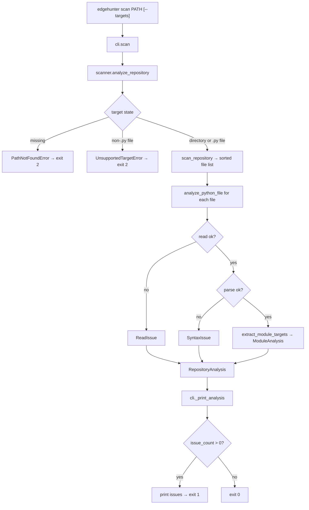

# EdgeHunter — System Flow

This file describes how data moves through the code that exists today. It is
updated whenever entry points, call order, stored data, or error paths change.
Only implemented behavior is described; future subsystems are not listed here.

---

## 1. Entry points

EdgeHunter is a library with a command-line front end.

```text
console script:  edgehunter             -> edgehunter.cli:main()      (pyproject [project.scripts])
module:          python -m edgehunter   -> edgehunter.__main__ -> edgehunter.cli.main()
in-process:      typer.testing.CliRunner -> the typer.Typer application (used by tests)
```

`main()` in `src/edgehunter/cli.py` calls the `typer.Typer` application
(`app`), which performs argument parsing and dispatch.

## 2. Command tree

```text
edgehunter
├── --version              (eager option on the root callback `_root_callback`)
└── scan PATH [--targets]  (command `scan`)
```

## 3. Flow: `edgehunter --version`

```text
app()                                          src/edgehunter/cli.py  — Typer application entry
 └─ _root_callback()                           src/edgehunter/cli.py  — group callback runs first
     └─ _version_callback(True)                src/edgehunter/cli.py  — eager option callback
         ├─ typer.echo("edgehunter 0.1.0")     prints version from edgehunter.__version__
         └─ raise typer.Exit()                 exits with code 0 before any command runs
```

Why: `is_eager=True` makes `--version` run before command resolution, so it
works even when no command is given.

## 4. Flow: `edgehunter scan PATH [--targets]`

Where the data comes from: the `PATH` argument typed by the user (a directory
or a single Python file) and the optional `--targets` flag. Nothing is read
from the network or environment, and no target code is imported or executed.

```text
app()                                          src/edgehunter/cli.py — Typer application entry
 └─ scan(path, targets)                        src/edgehunter/cli.py — command entry; PATH parsed as pathlib.Path
     ├─ analyze_repository(target)             src/edgehunter/scanner/repository.py — library entry
     │   ├─ scan_repository(target)            filesystem discovery (see section 5); returns ScanSummary
     │   │   ├─ _resolve_target(target)        canonicalizes input; raises PathNotFoundError / ScanError
     │   │   └─ _walk_python_files(resolved)   directory branch, or single-file branch; sorted file list
     │   └─ analyze_python_file(path, rel)     src/edgehunter/scanner/ast_parser.py — once per file, discovery order
     │       ├─ _read_source(path)             tokenize.open → PEP 263 encoding rules
     │       │   └─ OSError/SyntaxError/UnicodeDecodeError → ReadIssue (scan continues)
     │       ├─ ast.parse(source)              SyntaxError → SyntaxIssue (scan continues)
     │       └─ extract_module_targets(tree)   src/edgehunter/scanner/targets.py
     │           ├─ _visit(...)                recursive walk; scope = module/class/function
     │           ├─ _build_function(...)       parameters, return annotation, decorators, owner, qualified name
     │           └─ _build_class(...)          bases, decorators, qualified name
     └─ _print_analysis(analysis, show_targets)
         ├─ counts                             discovered/parsed/issues, classes/functions/methods/async/callable
         ├─ _print_issues(analysis)            Syntax issues and Read issues sections when present
         └─ _print_targets(analysis)           only with --targets; path:line plus static signature per target
```

Where the data ends up: stdout (statistics, issues, optional target list).
Nothing is written to disk and no state is kept between invocations.

Error behavior: `ScanError` (missing path, unsupported target) prints
`error: <message>` to stderr and exits 2 (`EXIT_INVALID_INPUT`). A scan that
completes but finds unreadable or unparseable files prints the issues and
exits 1 (`EXIT_SCAN_ISSUES`). A clean scan exits 0. Unexpected exceptions
propagate unchanged (traceback, non-zero exit) because they indicate bugs.

Why it works this way: discovery stays in `scan_repository()` (Phase 0,
unchanged), file analysis is one pure function, and repository-level
aggregation lives in `analyze_repository()`. The CLI only formats results, so
each layer is testable in isolation and the no-execution boundary stays in one
place: `analyze_python_file()` reads text and calls `ast.parse` only.

## 5. Discovery rules (policy, `src/edgehunter/scanner/repository.py`)

- Include: files whose name ends in `.py` (exact case).
- Prune: directories named `.eggs`, `.git`, `.hg`, `.hypothesis`, `.mypy_cache`, `.nox`, `.pytest_cache`, `.ruff_cache`, `.svn`, `.tox`, `.venv`, `__pycache__`, `build`, `dist`, `env`, `node_modules`, `site-packages`, `venv`, `virtualenv`, and any directory whose name ends in `.egg-info`.
- Do not follow symlinks (`os.walk` default `followlinks=False`).
- Visit names in sorted order so results are deterministic.

## 6. Analysis rules (src/edgehunter/scanner/ast_parser.py, targets.py, models.py)

- Reading: `tokenize.open` (BOM and PEP 263 coding cookies). Failures become `ReadIssue`.
- Parsing: `ast.parse` only; no imports, `eval`, `exec`, or subprocess of any kind.
- Target kinds: immediate lexical scope decides method vs nested function vs function; `async def` selects the async variant. Compound statements (`if`/`try`/loops/`with`/`match`) do not change scope.
- Qualified names: dotted lexical path within the file (`Outer.Inner.run`, `outer.inner`); no package resolution yet.
- Ordering: files in discovery order (a directory's files before its subdirectories, each sorted); functions and classes within a module sorted by `(lineno, qualified_name)`.
- Annotations, decorators, and bases are stored as `ast.unparse` output (source text); defaults are recorded only as `has_default`.
- Issues: at most one `SyntaxIssue` (line/column/message from `SyntaxError`) or `ReadIssue` (exception message) per file; analysis of other files continues.

## 7. Diagram



## Changes in this session (Phase 0: Repository Bootstrap and Engineering Foundation)

| Area | Change | Files | Commit | Decision |
|---|---|---|---|---|
| packaging | Created `pyproject.toml` (setuptools backend, dynamic version, console script, dev extra, tool config) | pyproject.toml | ac9b228 | D-001, D-002, D-006 |
| package | Created `src/edgehunter/` package with `__init__.py` (literal `__version__ = "0.1.0"`) and `__main__.py` | src/edgehunter/__init__.py, src/edgehunter/__main__.py | ac9b228 | D-001, D-002 |
| CLI | Added Typer application with `--version` callback and `scan PATH` command; invalid input exits with code 2 | src/edgehunter/cli.py | ac9b228 | D-003, D-005 |
| scanner | Added filesystem discovery (`scan_repository`, `ScanSummary`, `ScanError` hierarchy, exclusion policy) | src/edgehunter/scanner/repository.py, src/edgehunter/scanner/__init__.py | ac9b228 | D-004 |
| tests | Added CLI tests (in-process + one subprocess entry-point test) and scanner tests | tests/test_cli.py, tests/test_repository_scanner.py | ac9b228 | D-007 |
| docs | Created `decisions.md`, `flow.md`, `.gitignore`, `README.md` | decisions.md, flow.md, .gitignore, README.md | ac9b228 | none |
| docs | Recorded real commit hashes in `decisions.md`/`flow.md`, added `handoff.md`, added D-008 (typer.testing-only imports) | decisions.md, flow.md, handoff.md | c729a70 | D-008 |

## Changes in this session (Phase 1 — Repository Scanner + Safe AST Extraction)

| Area | Change | Files | Commit | Decision |
|---|---|---|---|---|
| scanner | Added immutable AST models (ParameterInfo, FunctionInfo, ClassInfo, ModuleAnalysis, SyntaxIssue, ReadIssue, kinds) | src/edgehunter/scanner/models.py | 82d42f3 | D-009, D-010, D-012 |
| scanner | Added scope-aware target extraction with qualified names, parameter kinds, annotations, decorators, line spans | src/edgehunter/scanner/targets.py | 82d42f3 | D-010 |
| scanner | Added safe file analysis: `tokenize.open` reading, `ast.parse`, structured issues | src/edgehunter/scanner/ast_parser.py | 82d42f3 | D-011, D-012, D-014 |
| scanner | Added `RepositoryAnalysis` and `analyze_repository()`; `ScanSummary`/`scan_repository()` unchanged | src/edgehunter/scanner/repository.py, src/edgehunter/scanner/__init__.py | 82d42f3 | D-009 |
| CLI | `scan` prints AST statistics and issue sections, supports `--targets`, exits 1 when issues exist | src/edgehunter/cli.py | 82d42f3 | D-013 |
| tests | Parser, safety, and aggregation tests; CLI tests updated for new output and exit codes | tests/test_ast_parser.py, tests/test_safety.py, tests/test_repository_analysis.py, tests/test_cli.py | 82d42f3 | D-010..D-014 |
| docs | Added decisions D-009..D-014 and updated this flow document | decisions.md, flow.md | 82d42f3 | none |
| docs | Recorded Phase 1 commit hash in `decisions.md`/`flow.md`, rewrote `handoff.md` | decisions.md, flow.md, handoff.md | 603b709 | none |
