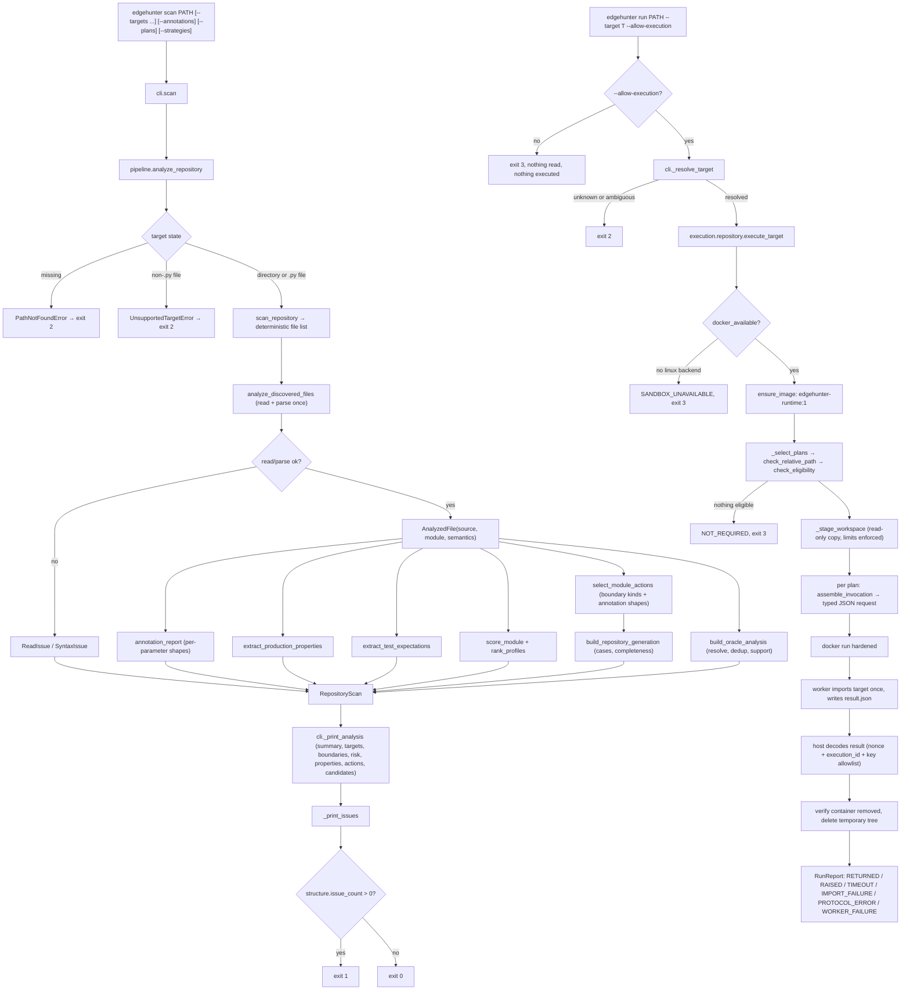

# EdgeHunter — System Flow

This file describes how data moves through the code that exists today. It is
updated whenever entry points, call order, stored data, or error paths change.
Only implemented behavior is described; future subsystems are not listed here.

---

## 1. Entry points

EdgeHunter is a library with a command-line front end.

```text
console script:  edgehunter             -> edgehunter.cli:main()      (pyproject [project.scripts])
module:          python -m edgehunter   -> edgehunter.__main__ -> edgehunter.cli.main()
in-process:      typer.testing.CliRunner -> the typer.Typer application (used by tests)
```

`main()` in `src/edgehunter/cli.py` calls the `typer.Typer` application
(`app`), which performs argument parsing and dispatch.

## 2. Command tree

```text
edgehunter
├── --version                        (eager option on the root callback `_root_callback`)
├── scan PATH [--targets] [--boundaries] [--risk] [--properties] [--actions] [--candidates]
│             [--annotations] [--plans] [--strategies]        (command `scan`)
└── run PATH --target NAME [--allow-execution] [--max-cases N] [--timeout S]
                                                       (command `run`)
```

`scan` is static only and never executes target code. `run` is the only command
that starts a container, and it requires an explicit target plus opt-in.

## 3. Flow: `edgehunter --version`

```text
app()                                          src/edgehunter/cli.py  — Typer application entry
 └─ _root_callback()                           src/edgehunter/cli.py  — group callback runs first
     └─ _version_callback(True)                src/edgehunter/cli.py  — eager option callback
         ├─ typer.echo("edgehunter 0.1.0")     prints version from edgehunter.__version__
         └─ raise typer.Exit()                 exits with code 0 before any command runs
```

Why: `is_eager=True` makes `--version` run before command resolution, so it
works even when no command is given.

## 4. Flow: `edgehunter scan PATH [--targets] ... [--annotations] [--plans] [--strategies]`

Where the data comes from: the `PATH` argument typed by the user (a directory
or a single Python file) plus the optional detail flags. Nothing is read from
the network or environment, and no target code is imported or executed.

```text
app()                                          src/edgehunter/cli.py — Typer application entry
 └─ scan(path, targets, boundaries, risk, properties, actions, candidates)
                                                 src/edgehunter/cli.py — command entry
     ├─ analyze_repository(target)             src/edgehunter/pipeline.py — composition root, ONE read+parse per file
     │   ├─ scan_repository(target)            src/edgehunter/scanner/repository.py — discovery (section 5)
     │   ├─ analyze_discovered_files(discovery)
     │   │                                     src/edgehunter/analysis/repository.py — per-file stage
     │   │   ├─ parse_source_file(path, rel)   src/edgehunter/scanner/ast_parser.py — read + parse ONCE
     │   │   │   └─ _read_source(path)         tokenize.open → PEP 263 encoding rules
     │   │   │       └─ OSError/SyntaxError/UnicodeDecodeError → ReadIssue
     │   │   │   └─ ast.parse(source)          SyntaxError → SyntaxIssue → SourceFile(tree | None)
     │   │   ├─ build_module_analysis(source)  structural facts from the same AST
     │   │   │   └─ extract_module_targets(tree)  src/edgehunter/scanner/targets.py
     │   │   └─ extract_module_semantics(source, module)
     │   │       └─ mine_module_boundaries(module, targets)  src/edgehunter/analysis/boundaries.py
     │   │   → AnalyzedFile(source, module, semantics)
     │   ├─ extract_production_properties(source, semantics)
     │   │                                     src/edgehunter/oracle/production.py — asserts + if/raise guards
     │   ├─ extract_test_expectations(source)   src/edgehunter/oracle/test_expectations.py — test files only
     │   ├─ score_module(module, semantics)     src/edgehunter/analysis/risk.py — per-target profile
     │   ├─ rank_profiles(profiles)              deterministic ordering
     │   ├─ select_module_actions(module, semantics)
     │   │                                     src/edgehunter/generation/actions.py — applicable actions per target
     │   ├─ build_oracle_analysis(production, expectations, modules)
     │   │                                     src/edgehunter/oracle/repository.py — dedup, resolution, support
     │   ├─ build_repository_generation(action_sets)
     │   │                                     src/edgehunter/generation/repository.py — single-action cases
     │   ├─ build_repository_planning(generation, modules, observed_literals)
     │   │                                     src/edgehunter/generation/planning.py — invocation plans
     │   │       ├─ plan_case(case, function, literals)
     │   │       │                             src/edgehunter/generation/invocation.py — baselines, placement, status
     │   │       │   └─ baseline_for(shape)     src/edgehunter/generation/baselines.py — trustworthy fillers
     │   │       └─ plan_strategies(path, function, actions)
     │   │                                     src/edgehunter/generation/strategy.py — deterministic plans
     │   └─ annotation_report(modules)         src/edgehunter/generation/planning.py — per-parameter shapes
     └─ _print_analysis(...)
         ├─ structural + semantic counts       from analysis.semantics
         ├─ _print_oracle_counts(...)           Oracle evidence block
         ├─ _print_generation_counts(...)       Semantic actions block
         ├─ _print_planning_counts(...)         Planning block
         ├─ _print_annotations(...)             only with --annotations
         ├─ _print_targets / _print_boundaries
         ├─ _print_risk(...)                   only with --risk
         ├─ _print_properties(...)             only with --properties
         ├─ _print_actions(...)                only with --actions
         ├─ _print_candidates(...)             only with --candidates
         ├─ _print_plans(...)                  only with --plans
         ├─ _print_strategies(...)             only with --strategies
         └─ _print_issues(structure)            source issues last
```

`generation.repository.build_repository_generation()` converts the per-target
action lists into the repository aggregate and into candidate cases; it runs
inside `analyze_repository()` alongside `build_oracle_analysis()`.

Where the data ends up: stdout (statistics, optional detail sections, source
issues). Nothing is written to disk and no state is kept between invocations.

Printed values pass through `cli.py::_display_text()`, a presentation-only
transform: it escapes every character outside printable ASCII (so a NUL byte, an
emoji, and a CJK character are never written to a terminal, whatever the host's
console encoding) and compacts anything longer than 80 rendered characters to a
prefix plus its true length. It never touches the stored `value_text`, so the
plans, the codec, and the execution layer all keep the exact literal. Values that
are already safe to print — `float("nan")`, `""`, `-0.0`, `[0, 0]` — are emitted
byte-identically, so the rule cannot silently change unrelated output.

Error behavior: `ScanError` (missing path, unsupported target) prints
`error: <message>` to stderr and exits 2 (`EXIT_INVALID_INPUT`). A scan that
completes but finds unreadable or unparseable files exits 1
(`EXIT_SCAN_ISSUES`). A clean scan exits 0. Oracle ambiguity, unresolved
expectations, symbolic actions, unsupported actions, unknown annotations, and
incomplete invocation plans never change the exit code: they are analysis
limitations, not malformed source. Unexpected exceptions
propagate unchanged because they indicate bugs.

Why it works this way: `pipeline.analyze_repository()` owns the single pass, so
structure, semantics, oracles, risk, actions, and plans all describe the same
bytes and cost one read and one parse per file. Annotation shapes are built from
the `ast.arg` annotation node the scanner already holds, so interpreting an
annotation introduces no second parse. `analysis.repository.analyze_repository_semantics()`
remains available as the Phase 2 entry point and is built from the same
per-file helper.

## 5. Discovery rules (policy, `src/edgehunter/scanner/repository.py`)

- Include: files whose name ends in `.py` (exact case).
- Prune: directories named `.eggs`, `.git`, `.hg`, `.hypothesis`, `.mypy_cache`, `.nox`, `.pytest_cache`, `.ruff_cache`, `.svn`, `.tox`, `.venv`, `__pycache__`, `build`, `dist`, `env`, `node_modules`, `site-packages`, `venv`, `virtualenv`, and any directory whose name ends in `.egg-info`.
- Do not follow symlinks (`os.walk` default `followlinks=False`).
- Visit names in sorted order so results are deterministic.

## 6. Analysis rules (src/edgehunter/scanner/ast_parser.py, targets.py, models.py)

- Reading: `tokenize.open` (BOM and PEP 263 coding cookies). Failures become `ReadIssue`.
- Parsing: `ast.parse` only; no imports, `eval`, `exec`, or subprocess of any kind.
- Target kinds: immediate lexical scope decides method vs nested function vs function; `async def` selects the async variant. Compound statements (`if`/`try`/loops/`with`/`match`) do not change scope.
- Qualified names: dotted lexical path within the file (`Outer.Inner.run`, `outer.inner`); no package resolution yet.
- Ordering: files in discovery order (a directory's files before its subdirectories, each sorted); functions and classes within a module sorted by `(lineno, qualified_name)`.
- Annotations, decorators, and bases are stored as `ast.unparse` output (source text); defaults are recorded only as `has_default`.
- Issues: at most one `SyntaxIssue` (line/column/message from `SyntaxError`) or `ReadIssue` (exception message) per file; analysis of other files continues.

## 7. Semantic fact rules (src/edgehunter/analysis/semantics.py)

- Predicates come from `if`, `while`, and `assert` only; `elif` yields its own predicate.
- Each predicate keeps its containing expression plus every comparison inside it, including inside `and`/`or` operands.
- Chained comparisons are decomposed into adjacent pairs (`0 < x <= 10` gives `0 < x` and `x <= 10`).
- Comparisons only originate inside predicates; operators map to a stable `ComparisonOperator` enum.
- Constants are recorded per literal occurrence with `bool` classified before `int`; `...` is not recorded; signed numerics (`-1`) come from an explicit `UnaryOp`-over-`Constant` helper, never `eval`/`literal_eval`.
- Arithmetic is recorded as maximal subexpressions only (`(x + y) * 2` is one record with both operators), with a context of return / assignment / annotated assignment / augmented assignment / expression. No folding or simplification.
- Traversal stops at nested `FunctionDef`, `AsyncFunctionDef`, `ClassDef`, and `Lambda`, so inner callables never donate facts to their parent; module- and class-level conditions belong to no target.
- A file that failed to read or parse contributes no facts; its `ReadIssue`/`SyntaxIssue` is the only report.
- Expressions are rendered with `render_source()`; `ExpressionInfo.simple` marks literals, bare names, and plain dotted chains as stable references.

## 8. Boundary mining rules (src/edgehunter/analysis/boundaries.py)

- Candidates are mined only for declared parameters; one side of a comparison must be a bare parameter name.
- If the parameter is on the right, the operator is inverted (`<`->`>`, `<=`->`>=`, `>`->`<`, `>=`->`<=`, `==`->`==`, `!=`->`!=`); `is`, `is not`, `in`, `not in` are never inverted.
- Both sides parameters: the syntactic left side wins, so no inverse relational candidate is emitted.
- References stay symbolic (`amount` at `balance`, never `balance - 1`).
- A reference must be a literal, bare name, or plain dotted name chain; calls, subscripts, and complex expressions are skipped while the comparison is still recorded.
- Inequality with an ordered reference gives `JUST_BELOW`/`AT_BOUNDARY`/`JUST_ABOVE`; `==`/`!=` give `AT_BOUNDARY` only; `is`/`in` give nothing; a non-numeric literal gives `AT_BOUNDARY` only.
- Generic numeric candidates require an annotation of exactly `int` (zero, one, negative one) or `float` (plus negative zero, NaN, +Infinity, -Infinity) on a positional-only, positional-or-keyword, or keyword-only parameter.
- Deduplicated by `(parameter, kind, reference)` per target, keeping every evidence line; ordered by `(parameter, kind rank, reference)`.
- No candidate is a bug claim: language is "candidate", "boundary", "interesting region", "static evidence".

## 9. Structural risk rules (src/edgehunter/analysis/risk.py)

- A search-priority heuristic, explicitly not a probability or bug estimate; total capped at 100.
- Contributions and caps: predicates +6 each (cap 30), arithmetic +4 each (cap 20), boundary groups +4 each (cap 20), input parameters +3 each (cap 15), source span +3 per started block of 20 lines (cap 15).
- A boundary group is a unique `(parameter, reference)` pair, so below/at/above for one reference count once and a float's generic numeric values count once.
- Source span uses the scanner's `lineno`/`end_lineno`, falling back to a single line; no source is re-read.
- A method's first `self`/`cls` parameter is not counted as user input.
- Ranking: score descending, then relative POSIX path, then line, then qualified name.
- Risk is independent of oracle support; neither is derived from the other.

## 10. Oracle mining rules (src/edgehunter/oracle/)

- Strength is categorical (`strong`), never a numeric confidence; no calibration exists.
- Production: `assert` predicates (reusing Phase 2 facts) plus the literal/rendered message, and `if COND: raise EXC` guards whose body is exactly one `raise`.
- Exception syntax: bare name, convention-suffixed name call (`Error`/`Exception`/`Warning`), or dotted call; anything else records no exception type.
- Test files (`test_*.py`, `*_test.py`) are excluded from production mining; their asserts are mined as expectations.
- Expectations: `assert <call> <op> <expected>` (reversed form normalized only for safely invertible operators) and `with pytest.raises(X):` with a single direct call body.
- Resolution: unique bare name → resolved; several → ambiguous; none → unresolved; dotted or chained receiver calls always unresolved. Unresolved evidence is retained, never discarded.
- Properties are deduplicated per module and across the repository, keeping every evidence line sorted.

## 11. Generation rules (src/edgehunter/generation/)

- The action vocabulary is closed: `SemanticActionKind` has twenty-one members and `BOUNDARY_ACTIONS` maps all ten `BoundaryKind` values one-to-one onto ten of them. The other eleven are annotation-driven and have no boundary counterpart: `SET_NONE`, the three collection shapes, the two boolean values, and the five string edge shapes. Nothing else can be proposed.
- Every action records its origin: `BOUNDARY` (a mined candidate justified it) or `ANNOTATION` (the declared annotation did).
- Actions are selected per parameter, deduplicated by `(parameter, kind, reference)`, and ordered by `(parameter, ACTION_KIND_ORDER, reference)`.
- Applicability for numeric actions comes from Phase 2's boundary candidates, whose annotation rule now reads the static shape: a nullable `int | None` is still an integer, and `bool` is still not numeric.
- Applicability for collection, boolean, string, and nullability actions is decided from the static annotation shape (section 12), not from annotation text, so `list[int]`, `dict[str, int]`, `bool`, `str`, and `int | None` are all recognized. A parameter whose shape is `UNKNOWN` gets no boolean or string action: a name such as `name`, `text`, or `flag` is not type evidence.
- Annotation-derived actions are restricted to single-value parameter buckets; `*args`/`**kwargs` never receive a generic action.
- Untyped parameters are not excluded: they still receive actions derived from their own comparisons.
- Materialization is `CONCRETE`, `SYMBOLIC`, or `UNSUPPORTED`. Integer literal references use exact neighbours (`9`/`10`/`11`); float references use `math.nextafter` and are rendered with `repr`; other literal kinds can be matched exactly but not stepped.
- A name or attribute reference stays symbolic: `AT_BOUNDARY` names it, and the below/above forms stay symbolic rather than inventing a neighbour.
- Stepping around a `complex` literal is `UNSUPPORTED`. Literal text is parsed with `int`/`float`, never `eval` or `ast.literal_eval`.
- Empty collections render as `[]`, `()`, `{}`, `set()` unconditionally, because an empty container needs no element knowledge. A singleton or repeated element renders only from a trustworthy element baseline (`[0]`, `("",)`, `{False}`, `{"": 0}`); an unknown element type is `UNSUPPORTED` with a reason, and no placeholder element is ever fabricated.
- A candidate case holds exactly one action. It never combines actions and never supplies a value for another parameter. Invocation planning (section 14) adds fillers above this layer without changing it.
- Boolean values are written as the Python literals `False` and `True` with `LiteralKind.BOOLEAN`, never as `0` and `1`, and `materialize_bool()` refuses a shape that is not `BOOL` rather than coercing it.
- The five string values are fixed constants: `""`, `" "`, `"é漢🙂"`, `"\x00"`, and `"a" * 1024`. `materialize_string()` refuses a shape that is not `STR`. The long-string length is the module constant `LONG_STRING_LENGTH`; neither the target nor the CLI can influence it, and the value is never truncated.
- `render_string_literal()` is the single rendering used for string values, so the action text, the strategy text, and the `str` baseline all spell one value identically and the by-text dedup below cannot list it twice.
- `missing_parameters` lists the target's required parameters a case leaves uncovered: no default, not `*args`/`**kwargs`, not a method's `self`/`cls` receiver.
- Completeness is `COMPLETE` (concrete, nothing required left), `PARTIAL` (concrete, other required parameters uncovered), or `SYMBOLIC` (value still depends on a name).
- Only `CONCRETE` and `SYMBOLIC` actions become cases; an `UNSUPPORTED` action stays in the action list with its reason.
- Cases are ordered by `(relative path, line, target, parameter, ACTION_KIND_ORDER, reference)`.
- Nothing is executed: a materialized value is Python source text for a later phase. No candidate case is a defect claim.

## 12. Annotation shape rules (src/edgehunter/scanner/annotations.py)

- `build_static_annotation(ast_expr)` is the single canonical annotation interpreter. It runs inside `scanner/targets._build_parameter`, so it costs no extra read and no extra `ast.parse`; the result is stored on `ParameterInfo.shape`.
- Recognized primitives: `int`, `float`, `bool`, `str`, and a bare `None`.
- Recognized containers, bare and subscripted: `list[T]`, `set[T]`, `tuple[T]`, `tuple[T, ...]`, `dict[K, V]`. A bare `list`/`tuple`/`set`/`dict` has the container kind but no element/key/value.
- Recognized `typing` spellings: `List[...]`, `Tuple[...]`, `Set[...]`, `Dict[...]`, `Optional[...]`, `Union[...]`, plus the `typing.`-prefixed forms of each. Recognition is syntactic; no import is resolved and nothing proves the name means what it appears to.
- PEP 604 unions: one recognized type plus `None` becomes that type with `nullable=True`. Any other multi-type union becomes `UNION`, which generates no values.
- `Union[X, None]` is normalized the same way as `X | None`.
- Nullability is a flag, not a kind, so `int | None` is `kind=INT, nullable=True` and every `INT` rule still applies. `description` renders it as `OPTIONAL[INT]`.
- Nested generics are represented recursively and do not crash; a heterogeneous fixed tuple such as `tuple[int, str]` records no element because it has no single element type.
- Everything else is `UNKNOWN` while keeping its rendered text: forward-reference strings, user aliases (`MyInt = int`), `Annotated`, `Literal`, `NewType`, `TypeVar`, `Protocol`, `Callable`, `Sequence`, `Mapping`, `Iterable`, `frozenset`, an annotation that is a call expression, and any non-`typing` qualifier such as `mylib.List[int]`.
- A forward-reference string is never parsed as code. An annotation expression is never evaluated.

## 13. Baseline rules (src/edgehunter/generation/baselines.py)

- A baseline is a filler for an argument with no adversarial intent. It is not an oracle and not a validity claim.
- Values: `int` → `0`, `float` → `0.0`, `bool` → `False`, `str` → `""`, `None` → `None`, and the empty container for each container kind.
- A nullable shape yields its non-null baseline, so `None` stays an adversarial choice (`SET_NONE`) rather than an automatic filler.
- `UNKNOWN` and `UNION` yield no baseline at all. There is no `None` fallback for an unrecognized type.
- Every baseline records a `BaselineSource` (`static_type_baseline`, `existing_test_baseline`, `declared_default`, `dependency_baseline`) and a reason stating it is a filler.
- Filler precedence: existing-test literal, then dependency baseline, then declared default (the parameter is omitted), then static type baseline, then nothing.
- Nothing is instantiated: no target-defined constructor is ever called.

## 14. Invocation planning rules (src/edgehunter/generation/invocation.py)

- Planning sits above the candidate layer: one `InvocationPlan` per `CandidateCase`, so plan count always equals case count.
- Exactly one assignment per plan has origin `adversarial_action`. Every other assignment is a filler with its own origin, so a failure can be attributed to the action.
- Placement comes from the Phase 1 `ParameterKind`: positional-only, positional, keyword, or omitted. `*args`/`**kwargs` receive no assignment and never affect completeness.
- A declared default satisfies completeness without being evaluated: the parameter is recorded as `declared_default` with placement `omitted` and no value.
- A method's `self`/`cls` is never synthesized; it sets `requires_receiver` and forces `NEEDS_RECEIVER`, so a method plan is never reported locally invocable.
- Status precedence, most fundamental gap first: `SYMBOLIC_DEPENDENCY`, `PARTIAL_ARGUMENTS`, `NEEDS_RECEIVER`, `COMPLETE_FUNCTION`.
- A symbolic reference resolves only when it names another parameter of the same target with a trustworthy baseline. The neighbour is computed by the same `materialize_relational()` used for literal references; there is one adjacency implementation. A dotted reference such as `self.limit` never resolves.
- Existing-test baselines use only literal arguments recorded during mining, and only from expectations that resolved to exactly one target.
- Plans are ordered by `(relative path, line, target, primary parameter, action kind, reference)`.

## 15. Strategy plan rules (src/edgehunter/generation/strategy.py)

- `StrategyPlan` describes how a parameter could be generated. It is framework-independent; no generator library is used and none is required.
- Deterministic example sets: `int` → `0`/`1`/`-1`; `float` → those plus `-0.0`, `NaN`, `±Infinity`; `bool` → `False`/`True`; `str` → `""`, `" "`, `"é漢🙂"`, `"\x00"`, and a 1024-character string (the same constants the string actions use, so the strategy cannot drift from the action layer); containers reuse the materializer's empty/singleton/repeated values; a nullable shape adds `None`.
- Boundary-derived values are labelled with the boundary and reference they came from, for example `just_above.10`.
- Values are deduplicated by rendered text, never by equality, because `NaN != NaN` would make equality-based deduplication unpredictable for the float specials. Sharing one renderer (`render_string_literal()`) with the string actions is what makes this dedup correct: two spellings of one value would otherwise become two rows listing the same input twice.
- `UNKNOWN` with a symbolic dependency is `SYMBOLIC`; `UNKNOWN` without one and `UNION` are `UNSUPPORTED`.
- `*args`/`**kwargs` receive no strategy entry.
- Strategies exist only for targets that have at least one action.
- No value is ever sampled or generated: the plan is a fixed, ordered table.

## 16. Execution rules (`src/edgehunter/execution/`, `src/edgehunter/runtime/`)

`run` is the only path that loads target code, and the load happens in one place:
`runtime/worker.py`, inside a container. Everything under `execution/` runs on the
host and treats the repository as data.

### 16.1 Authorization and backend availability

```text
edgehunter run PATH --target T [--allow-execution]
 └─ run()                                             src/edgehunter/cli.py
     ├─ no --allow-execution ──────────────────────► exit 3, repository never read
     ├─ analyze_repository(path)                    (identical to the scan path; static only)
     ├─ _resolve_target(analysis, target)           resolves `name` or `path::name`
     │    ├─ zero matches ─────────────────────────► exit 2, "no analyzed target matched"
     │    ├─ two+ matches ─────────────────────────► exit 2, "more than one file", shows how to qualify
     │    └─ exactly one match ────────────────────► carries the file hint through to the execution layer
     └─ execute_target(...)                         src/edgehunter/execution/repository.py
          └─ docker_available()                    src/edgehunter/execution/docker.py
               ├─ no CLI / daemon unreachable / OSType != linux ──► SandboxState.UNAVAILABLE, exit 3
               └─ linux ──────────────────────────► ensure_image() builds edgehunter-runtime:1 from
                                                    runtime_context() if `docker image inspect` misses
```

Exit codes for `run`: `0` observed run, `2` invalid input, `3` refused or
unavailable. `1` is never used by `run`, so it cannot be confused with the
scanner's "issues found" code.

### 16.2 Selection, eligibility, and staging

```text
execute_target
 ├─ _select_plans(scan, options)                   repository.py
 │    ├─ collect modules defining the qualified name, apply the file hint
 │    ├─ 0 matches ──► UNKNOWN_TARGET ; >1 ──► AMBIGUOUS_TARGET (both stop here)
 │    └─ for each plan with matching target AND relative_path:
 │         ├─ check_relative_path()                eligibility.py  (posix + windows reading)
 │         ├─ check_eligibility(plan, function)    eligibility.py
 │         │     status, kind, decorators, relative path, supported values
 │         └─ keep eligible, truncate to bounded_case_limit() (max 20)
 ├─ no eligible plan ──► SandboxState.NOT_REQUIRED, exit 3, no container started
 └─ _stage_workspace(source_root, run_root)        staging.py
       discover_python_sources → stage_source
         ├─ containment check, symlink refusal, .py only, ≤100 files,
         │  ≤1 MiB per file, ≤8 MiB total
         └─ StagingError ⇒ SandboxState.ERROR with the specific failure
```

### 16.3 One container per plan

```text
_execute_one(plan, function, staged, run_root, timeout)          repository.py
 ├─ assemble_invocation(plan, function)                          assembly.py
 │     positional run closes at the first OMITTED parameter; unsupported values refuse
 ├─ _request_document(request)                                   codec.py
 │     dumps() then check_document_size(): an oversized request never starts a container
 ├─ build_run_command(...)                                       docker.py
 │     docker run --rm --network none --read-only --cap-drop ALL
 │               --security-opt no-new-privileges --pids-limit 64
 │               --memory 256m --cpus 1.0 --user 65534:65534
 │               --tmpfs /tmp:rw,nosuid,nodev,size=16m
 │               --mount workspace=…,target=/workspace,readonly
 │               --mount request=…,target=/input,readonly
 │               --mount output=…,target=/output   edgehunter-runtime:1
 ├─ run_docker(command, timeout_seconds, cleanup_command)        docker.py
 │     file-backed capture bounded at 64 KiB; timeout or non-zero exit runs
 │     `docker rm --force`; stdin is DEVNULL; shell=False throughout
 ├─ container_exists(name) ──► if true: remove, then re-check and report
 └─ _decode_outcome(...)                                        repository.py
       ├─ timed_out ───────────────────────────────► TIMEOUT
       ├─ no result document ──────────────────────► WORKER_FAILURE  (never a silent pass)
       ├─ unreadable document / unknown keys ──────► PROTOCOL_ERROR
       ├─ nonce mismatch ─────────────────────────► PROTOCOL_ERROR
       ├─ execution_id mismatch ───────────────────► PROTOCOL_ERROR
       └─ accepted ───────────────────────────────► RETURNED / RAISED / IMPORT_FAILURE / …
```

### 16.4 Inside the container

```text
python -m edgehunter.runtime.worker               src/edgehunter/runtime/worker.py
 ├─ codec imported at module load, BEFORE the staged tree reaches sys.path
 ├─ _read_request()                               64 KiB cap, version check, JSON parse
 ├─ _resolve_target(relative_file)                posix containment, .py only, must exist
 ├─ _decode_arguments(invocation)                 decode_value → plain Python inside the sandbox only
 └─ redirect_stdout/stderr → _BoundedStream, fds 1 and 2 → /dev/null
      ├─ _load_callable()                         importlib.util.spec_from_file_location + exec_module
      │     BaseException here ───────────────────► IMPORT_FAILURE  (function never called)
      │     attribute missing / not callable ─────► TARGET_NOT_FOUND
      ├─ function(*args, **kwargs)                exactly once
      │     BaseException ────────────────────────► RAISED + exception_type + exception_message
      │       └─ _exception_identity(exc)         module/qualname/builtin/lineage, safe metadata only
      └─ _encode_return(value)                    exact `type() is` checks
            representable ────────────────────────► RETURNED + return_value
            otherwise ────────────────────────────► RETURNED + opaque_return
  └─ write /output/result.json                     nonce + execution_id echoed back
```

The staged tree is appended to `sys.path`, never prepended, so a staged module
cannot shadow a standard-library module the worker relies on.

### 16.4.1 Observed exception identity (`_exception_identity`)

```text
_exception_identity(exc)                          runtime/worker.py
 ├─ type(exc)                                     the class object itself
 ├─ type.__getattribute__(cls, "__module__")       NOT cls.__module__
 │     └─ why: ordinary attribute access runs a custom metaclass's
 │               __getattribute__, which is target code on the observation path
 ├─ type.__getattribute__(cls, "__qualname__")    same reason
 ├─ _builtin_lineage(cls)                         walk the real __mro__
 │    └─ each base tested by IDENTITY against _trusted_builtin_exception_classes()
 │         └─ built from vars(builtins) — a fact about the standard library
 └─ exception_builtin = cls in _trusted_builtin_exception_classes()
```

Emitted fields, all optional: `exception_module`, `exception_qualname`,
`exception_builtin` (boolean), `exception_builtin_lineage` (list of names, most
derived first, at most 16). Each is omitted when it cannot be read safely, so
"unknown" stays distinguishable from "recorded". Nothing calls `repr`, `str`, or
any method on the exception or its class, and nothing is serialized.

The consequence that matters: a target's own `class ValueError(Exception)` has
`exception_builtin = False` and a lineage that does **not** contain `ValueError`,
while the real `builtins.ValueError` reports `True`. A name comparison could not
tell them apart; class identity can.

The worker image is cached. After editing `runtime/worker.py`, an old
`edgehunter-runtime:1` still contains the previous worker and produces documents
without these fields; the host reads them as unknown and keeps the Phase 6B
name-only verdicts. `docker image rm edgehunter-runtime:1` forces the rebuild.

### 16.5 Cleanup

`_cleanup_problems()` removes the staged copy and the temporary execution
directory without `ignore_errors`; any `OSError` is folded into the report's
sandbox detail rather than suppressed.

## 17. Diagram



## Changes in this session (Phase 0: Repository Bootstrap and Engineering Foundation)

| Area | Change | Files | Commit | Decision |
|---|---|---|---|---|
| packaging | Created `pyproject.toml` (setuptools backend, dynamic version, console script, dev extra, tool config) | pyproject.toml | ac9b228 | D-001, D-002, D-006 |
| package | Created `src/edgehunter/` package with `__init__.py` (literal `__version__ = "0.1.0"`) and `__main__.py` | src/edgehunter/__init__.py, src/edgehunter/__main__.py | ac9b228 | D-001, D-002 |
| CLI | Added Typer application with `--version` callback and `scan PATH` command; invalid input exits with code 2 | src/edgehunter/cli.py | ac9b228 | D-003, D-005 |
| scanner | Added filesystem discovery (`scan_repository`, `ScanSummary`, `ScanError` hierarchy, exclusion policy) | src/edgehunter/scanner/repository.py, src/edgehunter/scanner/__init__.py | ac9b228 | D-004 |
| tests | Added CLI tests (in-process + one subprocess entry-point test) and scanner tests | tests/test_cli.py, tests/test_repository_scanner.py | ac9b228 | D-007 |
| docs | Created `decisions.md`, `flow.md`, `.gitignore`, `README.md` | decisions.md, flow.md, .gitignore, README.md | ac9b228 | none |
| docs | Recorded real commit hashes in `decisions.md`/`flow.md`, added `handoff.md`, added D-008 (typer.testing-only imports) | decisions.md, flow.md, handoff.md | c729a70 | D-008 |

## Changes in this session (Phase 1 — Repository Scanner + Safe AST Extraction)

| Area | Change | Files | Commit | Decision |
|---|---|---|---|---|
| scanner | Added immutable AST models (ParameterInfo, FunctionInfo, ClassInfo, ModuleAnalysis, SyntaxIssue, ReadIssue, kinds) | src/edgehunter/scanner/models.py | 82d42f3 | D-009, D-010, D-012 |
| scanner | Added scope-aware target extraction with qualified names, parameter kinds, annotations, decorators, line spans | src/edgehunter/scanner/targets.py | 82d42f3 | D-010 |
| scanner | Added safe file analysis: `tokenize.open` reading, `ast.parse`, structured issues | src/edgehunter/scanner/ast_parser.py | 82d42f3 | D-011, D-012, D-014 |
| scanner | Added `RepositoryAnalysis` and `analyze_repository()`; `ScanSummary`/`scan_repository()` unchanged | src/edgehunter/scanner/repository.py, src/edgehunter/scanner/__init__.py | 82d42f3 | D-009 |
| CLI | `scan` prints AST statistics and issue sections, supports `--targets`, exits 1 when issues exist | src/edgehunter/cli.py | 82d42f3 | D-013 |
| tests | Parser, safety, and aggregation tests; CLI tests updated for new output and exit codes | tests/test_ast_parser.py, tests/test_safety.py, tests/test_repository_analysis.py, tests/test_cli.py | 82d42f3 | D-010..D-014 |
| docs | Added decisions D-009..D-014 and updated this flow document | decisions.md, flow.md | 82d42f3 | none |
| docs | Recorded Phase 1 commit hash in `decisions.md`/`flow.md`, rewrote `handoff.md` | decisions.md, flow.md, handoff.md | 603b709 | none |

## Changes in this session (Phase 2 — Static Semantic Analysis + Boundary Mining)

| Area | Change | Files | Commit | Decision |
|---|---|---|---|---|
| scanner | Split the pipeline so each file is read/parsed once: added `SourceFile`, `parse_source_file()`, `build_module_analysis()`, `CallableNode`, `collect_callable_nodes()`, and shared `scanner/rendering.py` | src/edgehunter/scanner/ast_parser.py, src/edgehunter/scanner/targets.py, src/edgehunter/scanner/rendering.py, src/edgehunter/scanner/__init__.py | b538557 | D-015 |
| analysis | Added the `analysis` package with immutable semantic and boundary models | src/edgehunter/analysis/__init__.py, src/edgehunter/analysis/models.py | b538557 | D-016, D-017 |
| analysis | Added predicate/comparison/constant/arithmetic extraction (if, while, assert; chained decomposition; bool kept out of numeric) | src/edgehunter/analysis/semantics.py | b538557 | D-016, D-020 |
| analysis | Added deterministic boundary mining with symbolic references, safe-reference rule, dedup, and ordering | src/edgehunter/analysis/boundaries.py | b538557 | D-017, D-018 |
| analysis | Added repository orchestration `analyze_repository_semantics()` returning structure plus semantics | src/edgehunter/analysis/repository.py | b538557 | D-015 |
| CLI | `scan` prints semantic statistics, gained `--boundaries`; exit codes unchanged | src/edgehunter/cli.py | b538557 | D-019 |
| tests | Added semantic extraction, boundary mining, repository aggregation, semantic no-execution, and CLI tests | tests/test_semantics.py, tests/test_boundaries.py, tests/test_semantic_repository.py, tests/test_safety.py, tests/test_cli.py | b538557 | D-016..D-020 |
| docs | Added decisions D-015..D-020 and updated this flow document | decisions.md, flow.md | b538557 | none |
| docs | Recorded Phase 2 commit hash in `decisions.md`/`flow.md`, rewrote `handoff.md` | decisions.md, flow.md, handoff.md | 603b709 | none |

## Changes in this session (Phase 3 — Risk Scoring + Oracle / Property Mining)

| Area | Change | Files | Commit | Decision |
|---|---|---|---|---|
| pipeline | Extracted the single parse pass into `analyze_discovered_files()`/`AnalyzedFile` and added the `pipeline.py` composition root | src/edgehunter/analysis/repository.py, src/edgehunter/pipeline.py | 12d82df | D-021 |
| analysis | Added explainable structural risk scoring with capped contributions, boundary grouping, receiver exclusion, and deterministic ranking | src/edgehunter/analysis/risk.py, src/edgehunter/analysis/models.py, src/edgehunter/analysis/__init__.py | 12d82df | D-022 |
| oracle | Added the `oracle` package: models, production mining, test-expectation mining, repository aggregation | src/edgehunter/oracle/__init__.py, src/edgehunter/oracle/models.py, src/edgehunter/oracle/production.py, src/edgehunter/oracle/test_expectations.py, src/edgehunter/oracle/repository.py | 12d82df | D-023..D-026 |
| scanner | Shared primitives: comparison inversion moved to `analysis/models.py`, added `iter_callable_body()` and `source_lineno()` | src/edgehunter/analysis/models.py, src/edgehunter/analysis/boundaries.py, src/edgehunter/scanner/targets.py, src/edgehunter/scanner/rendering.py, src/edgehunter/scanner/__init__.py | 12d82df | D-028 |
| CLI | `scan` gained `--risk` and `--properties`, an oracle-evidence summary block, and the fixed section order (issues last) | src/edgehunter/cli.py | 12d82df | D-027 |
| tests | Added risk, production-oracle, test-expectation, and pipeline tests; extended safety and CLI tests | tests/test_risk.py, tests/test_oracle_production.py, tests/test_oracle_test_expectations.py, tests/test_pipeline.py, tests/test_safety.py, tests/test_cli.py | 12d82df | D-021..D-027 |
| docs | Added decisions D-021..D-028 and updated this flow document | decisions.md, flow.md | 12d82df | none |

## Changes in this session (Phase 4 — Semantic Action Engine + Input Materialization)

| Area | Change | Files | Commit | Decision |
|---|---|---|---|---|
| scanner | Moved structural parameter constants up for reuse: `RECEIVER_PARAMETER_NAMES`, `SINGLE_VALUE_PARAMETER_KINDS` next to `METHOD_KINDS` | src/edgehunter/scanner/models.py, src/edgehunter/scanner/__init__.py | 1500640 | D-035 |
| analysis | Boundary applicability now uses the shared single-value buckets; risk reuses the shared receiver names and public `METHOD_KINDS` instead of private copies | src/edgehunter/analysis/boundaries.py, src/edgehunter/analysis/risk.py | 1500640 | D-035 |
| generation | Added the `generation` package with immutable action, materialization, and candidate models | src/edgehunter/generation/models.py, src/edgehunter/generation/__init__.py | 1500640 | D-029, D-030, D-031 |
| generation | Added materialization of actions into concrete/symbolic/unsupported values: integer neighbours, `math.nextafter` floats, exact literal matching, symbolic names | src/edgehunter/generation/materialize.py | 1500640 | D-031, D-033 |
| generation | Added action selection: total `BoundaryKind` → action mapping, bare-collection annotation categories, dedup, deterministic ordering | src/edgehunter/generation/actions.py | 1500640 | D-029, D-030, D-035 |
| generation | Added repository aggregation and single-action candidate cases with `missing_parameters` and completeness | src/edgehunter/generation/repository.py | 1500640 | D-032 |
| pipeline | `RepositoryScan` gained `generation`; action selection reuses the already-parsed AST in the same single pass | src/edgehunter/pipeline.py | 1500640 | D-029, D-032 |
| CLI | `scan` gained `--actions` and `--candidates`, a nine-line "Semantic actions" summary block, and actions/candidates before source issues | src/edgehunter/cli.py | 1500640 | D-034 |
| tests | Added action, materialization, and candidate-case suites; extended pipeline, CLI, and safety tests | tests/test_generation_actions.py, tests/test_generation_materialize.py, tests/test_generation_cases.py, tests/test_pipeline.py, tests/test_cli.py, tests/test_safety.py | 1500640 | D-029..D-034 |
| docs | Added decisions D-029..D-035 and updated this flow document | decisions.md, flow.md | 1500640 | none |


## Changes in this session (Phase 5 — Static Annotation Shapes + Safe Baselines + Strategy Planning)

| Area | Change | Files | Commit | Decision |
|---|---|---|---|---|
| scanner | Added the canonical annotation interpreter and built each shape from the `ast.arg` node during the existing traversal; stored on `ParameterInfo.shape` | src/edgehunter/scanner/annotations.py, src/edgehunter/scanner/models.py, src/edgehunter/scanner/targets.py, src/edgehunter/scanner/__init__.py | 4c6b922 | D-036 |
| analysis | Boundary applicability reads the annotation shape, so nullable integers receive numeric candidates | src/edgehunter/analysis/boundaries.py | 4c6b922 | D-036 |
| generation | Removed the `None` element placeholder; collection values now come from element baselines | src/edgehunter/generation/materialize.py | 4c6b922 | D-037 |
| generation | Extended the action vocabulary with `SET_NONE` and `DUPLICATE_ELEMENT_COLLECTION`; annotation applicability keyed on shape | src/edgehunter/generation/models.py, src/edgehunter/generation/actions.py | 4c6b922 | D-038 |
| generation | Added safe baseline synthesis with explicit provenance and fixed filler precedence | src/edgehunter/generation/baselines.py | 52fb551 | D-039 |
| generation | Added typed invocation plans: one adversarial assignment, placement, declared defaults, receiver requirement, four statuses | src/edgehunter/generation/invocation.py | 52fb551 | D-040 |
| generation | Added symbolic parameter-reference resolution reusing the one adjacency materializer | src/edgehunter/generation/invocation.py | 52fb551 | D-041 |
| generation | Added the framework-independent strategy-plan layer; Hypothesis deliberately not added | src/edgehunter/generation/strategy.py | 52fb551 | D-043 |
| generation | Added repository aggregation: one plan per case, one strategy plan per target, annotation report | src/edgehunter/generation/planning.py | 52fb551 | D-040, D-043 |
| oracle | Recorded literal-only test-call arguments for use as observed baselines | src/edgehunter/oracle/models.py, src/edgehunter/oracle/test_expectations.py | 52fb551 | D-042 |
| pipeline | `RepositoryScan` gained `planning` and `annotations`; observed literals feed the planner | src/edgehunter/pipeline.py | 52fb551 | D-040, D-042 |
| CLI | `scan` gained `--annotations`, `--plans`, `--strategies`, a Planning summary block, and plans/strategies before source issues | src/edgehunter/cli.py | 52fb551 | D-044 |
| tests | Added annotation, invocation, and strategy suites; extended boundary, action, case, CLI, pipeline, and safety tests | tests/test_annotations.py, tests/test_invocation.py, tests/test_strategy.py, tests/test_boundaries.py, tests/test_generation_actions.py, tests/test_generation_cases.py, tests/test_generation_materialize.py, tests/test_cli.py, tests/test_pipeline.py, tests/test_safety.py | 52fb551 | D-036..D-044 |
| docs | Added decisions D-036..D-044 and updated this flow document | decisions.md, flow.md | 4c6b922, 52fb551 | none |

## Changes in this session (Phase 6A - Isolated Execution Backend)

| Area | Change | Files | Commit | Decision |
|---|---|---|---|---|
| protocol | Added strict typed-value codec: `ValueKind`, rendered-literal recognition by AST whitelist, special-float text form, deterministic set ordering, depth/size/item limits | src/edgehunter/execution/codec.py | 89865f7 | D-046 |
| models | Added typed outcomes, eligibility reasons, `ExecutionRequest`, `RuntimeObservation`, `ExecutionResult`, `SandboxStatus`, `StagedSource`, `RunReport` | src/edgehunter/execution/models.py | 89865f7 | D-057 |
| assembly | Added deterministic argument assembly that closes the positional run at the first omitted default | src/edgehunter/execution/assembly.py | 89865f7 | D-049 |
| eligibility | Added status/kind/decorator/path/value gate; path checked as both POSIX and Windows | src/edgehunter/execution/eligibility.py | 89865f7 | D-053 |
| staging | Added `.py`-only staging with containment, symlink refusal, per-file and total size limits, and cleanup | src/edgehunter/execution/staging.py | 89865f7 | D-055 |
| backend | Added hardened `docker run` builder, availability check, bounded file-backed capture, timeout, forced cleanup, container verification | src/edgehunter/execution/docker.py | 89865f7 | D-045, D-051, D-055 |
| orchestration | Added plan selection with unambiguous target identity, image preparation, staging, one container per plan, and result decoding with nonce/ID/key allowlist | src/edgehunter/execution/repository.py | 89865f7 | D-052, D-057 |
| worker | Added the container-only target loader/invoker: bounded output sink, fd discard, single invocation, exact-type return encoding | src/edgehunter/runtime/worker.py | 89865f7 | D-047, D-048, D-050, D-054 |
| image | Added the packaged, digest-pinned worker `Dockerfile` and its package-data declaration | src/edgehunter/runtime/Dockerfile, pyproject.toml | 89865f7 | D-056 |
| CLI | Added `run` with `--target`, `--allow-execution`, `--max-cases`, `--timeout`; ambiguous or unknown targets exit 2; exit 1 is unused by `run` | src/edgehunter/cli.py | 89865f7 | D-052, D-057 |
| tests | Added codec, assembly, eligibility, staging, docker-argument, worker-protocol, boundary, CLI, and real-Docker integration suites; registered the `integration` marker | tests/test_execution_*.py, pyproject.toml | 89865f7 | D-045 to D-057 |
| docs | Recorded D-045 to D-057 including three defect fixes with symptom, root cause, and regression test | decisions.md, flow.md | 89865f7 | D-046 to D-057 |

## 18. Oracle evaluation rules (`src/edgehunter/evaluation/`)

`run --evaluate` is the only path that judges an observation. It runs entirely on
the host, after the container is gone, over data the protocol already decoded.

### 18.1 Applicability runs before evaluation

```text
TestExpectationCandidate  +  InvocationSignature  +  BoundCall
        │                          │                    │
        └──────────────────────────┴────────────────────┘
                            check_applicability()      applicability.py
```

Applicability requires all four of:

- the expectation resolved to exactly one target, and it is the executed target
- every recorded argument is literal syntax (no fixture, name, or constructor)
- no `*args` / `**kwargs`
- the same arguments bound to the same parameter names through the signature

Both sides become a `BoundCall` of canonical `(parameter, value text)` pairs, so
the comparison is structural and never touches a user-defined `__eq__`.

```text
add(1, 2)      and add(a=1, b=2)   ──► same bindings ──► APPLICABLE
add(1, 2)      and add(0, 2)       ──► ARGUMENTS_DIFFER ──► NOT_APPLICABLE
add(fixture, 2)                    ──► ARGUMENTS_NOT_LITERAL ──► UNSUPPORTED
parse("x") with two `parse`s       ──► AMBIGUOUS_TARGET ──► INCONCLUSIVE
f(1)           and f(1, 10)       ──► ARGUMENTS_DIFFER (defaults never evaluated)
```

### 18.2 Statuses

| Status | Raised when |
|---|---|
| `MATCH` | An applicable oracle was evaluated and the observation satisfied it. |
| `MISMATCH` | An applicable oracle was evaluated and the observation contradicted it. |
| `NOT_APPLICABLE` | The oracle does not cover this target, input, or invocation. |
| `INCONCLUSIVE` | Timeout, import failure, unavailable sandbox, ambiguous expectation, or unverified source snapshot. |
| `UNSUPPORTED` | The comparison or runtime feature is outside what this phase supports. |
| `CONFLICTING_EVIDENCE` | Applicable expectations disagree; both locations retained, no defect claimed. |

Execution status is a separate dimension and is never rewritten:

```text
Execution: RAISED    Oracle: MATCH   ← normal; this is what pytest.raises verifies
Execution: RETURNED  Oracle: MISMATCH ← normal; the test expected an exception
Execution: RAISED    Oracle: INCONCLUSIVE ← infrastructure failure, not a violation
```

### 18.3 Evaluation call tree

```text
evaluate_run()                                    repository.py
 ├─ target_functions(scan, identity)              repository.py  — reuses the single parse
 ├─ SourceSnapshot.verify(analyzed, digests, path) repository.py — SHA-256 equality
 ├─ summarize_attempts((first, *rechecks))        repository.py
 │   └─ _attempt_status(...)                      evaluator.py
 │       ├─ evaluate_observation(...)             evaluator.py
 │       │   ├─ expectations_for_target(...)      applicability.py — indexed by target
 │       │   └─ evaluate_oracle(...)              evaluator.py
 │       │       ├─ check_applicability(...)      applicability.py  FIRST, always
 │       │       │   └─ bind_recorded_call(...)   applicability.py  — literal recognition only
 │       │       ├─ _evaluate_raises(...)         evaluator.py
 │       │       │   └─ match_exception(...)      exceptions.py      — builtin hierarchy
 │       │       └─ _evaluate_returns(...)        evaluator.py
 │       │           ├─ _compare(...)             evaluator.py
 │       │           │   ├─ recognize_literal(...) codec.py           — AST whitelist
 │       │           │   ├─ materialize(...)      values.py           — built-ins only
 │       │           │   └─ compare_typed_values() compare.py          — Python's operators
 │       │           └─ canonical_value_text(...) values.py           — NaN / -0.0 safe
 │       │   └─ reconcile(evaluated)          evaluator.py       — conflicts, not a pick
 │       └─ observation_key(result)                evaluator.py       — identity, not equality
 └─ build_evaluation_report(...)                   repository.py
     ├─ assertion_observed(...)                    evaluator.py       — ASSERTION_OBSERVED
     ├─ guard_evidence(...)                        evaluator.py       — context only, never evaluated
     ├─ reconcile(...)                             evaluator.py
     └─ build_findings(...)                        findings.py
         └─ deduplicate_findings(...)              findings.py       — deterministic key
```

### 18.3.1 Exception identity and matching (Phase 7A)

```text
RuntimeObservation                    execution/models.py
 ├─ exception_type            (bare name, as before)
 ├─ exception_module          (new, optional)
 ├─ exception_qualname        (new, optional)
 ├─ exception_builtin         (new, bool | None — None means never observed)
 └─ exception_builtin_lineage (new, tuple | None)
        │
        └─ identity_from_observation(observation)      evaluator.py
              └─ ExceptionIdentity                    evaluation/exceptions.py
                     └─ match_exception_observed(expected, identity,
                                                  expected_binding=...)   exceptions.py
```

`match_exception_observed()` decides in this order:

```text
expected is None                       ──► INCONCLUSIVE
no observation at all                  ──► INCONCLUSIVE
test module binds the expected name    ──► INCONCLUSIVE   (shadowing, D-076)
expected is not a builtin class        ──► INCONCLUSIVE   (always, D-075)
─────────────────────────────────────────────────────────────────────────────
expected IS a builtin class:
  observed.exception_builtin is True
      name is a builtin descendant     ──► MATCH  (matched_subclass=True)
      otherwise                        ──► MISMATCH
  observed.exception_builtin is False
      lineage contains the expected    ──► MATCH  (matched_subclass=True)
      lineage lacks it (proven)        ──► MISMATCH
      lineage unknown (None)           ──► INCONCLUSIVE
  observed.exception_builtin is None   ──► Phase 6B name-only rules, unchanged
```

The two things this ladder deliberately refuses:

* **A custom expected class is never matched.** `pytest.raises(app.errors.
  InvalidInput)` against an observed `app.errors.InvalidInput` stays
  `INCONCLUSIVE`, because the test module's own binding of that name is unknown
  and resolving it needs import resolution, which is not performed.
* **A name difference is never a mismatch by itself.** Only a real MRO walk
  against the trusted builtin classes can conclude a non-derivation.

### 18.4 Comparison rules

- `==`, `!=`, `<`, `<=`, `>`, `>=` apply **Python's own** operator semantics, so
  `True == 1` is satisfied by an integer `1` and an existing passing test is never
  reported as a mismatch.
- A comparison Python itself refuses with `TypeError` is `UNSUPPORTED`, never
  `MISMATCH`.
- `is` / `is not` are supported only against `None`. Identity between arbitrary
  values is not observable, and `==` is not a substitute.
- Only built-ins are ever materialized. A return the codec could not represent is
  `opaque_return`, and the verdict is `UNSUPPORTED`.
- Observation identity is canonical **text**: outcome kind plus typed value (or
  exception class). Durations, execution ids, container ids, and temporary paths
  are excluded. `NaN` and `-0.0` get distinct descriptors.

### 18.5 Source snapshot verification

```text
ModuleAnalysis.digest          (SHA-256 during the single read)
        ==                    equal?
StagedSource.digests[path]     (SHA-256 of the bytes actually written)
        │
        ├── equal ──► verified, evaluation proceeds
        └── differ / missing ──► INCONCLUSIVE
                "source snapshot not verified"
```

No Git commit hash is used: a target repository may not be a repository. Digests
are captured into `RunReport.staged_digests` before the temporary tree is deleted,
so verification survives cleanup.

### 18.6 Reproduction

```text
--recheck N        opt-in, clamped to HARD_MAX_RECHECKS = 5
                    total containers per plan ≤ 6

every attempt ──► same staged snapshot, new nonce, new execution id

attempts:    verdict sequence              → ReproductionStatus
             M,M,M                        → REPRODUCED
             M,X,M                        → FLAKY
             M, INCONCLUSIVE (sandbox)    → RECHECK_FAILED
             single attempt, no request   → NOT_RECHECKED
```

An attempt that could not run is a failure, never confirmation. Attempts are
compared by `observation_key()`, never by raw document equality.

### 18.7 Findings

```text
FindingKind:  OBSERVED_EXPECTATION_MISMATCH    one execution contradicted one expectation
              REPRODUCED_EXPECTATION_MISMATCH every requested attempt agreed
              ASSERTION_OBSERVED              a production assertion fired; review required
              SUSPICIOUS_BEHAVIOR              interesting, with no applicable oracle
              INCONCLUSIVE                    conflicting or undecidable

no MATCH finding        no UNSUPPORTED finding        no severity field at all
```

Identifiers are `ehf-` + 12 hex of SHA-256 over target identity, source
fingerprint, oracle location, invocation, and category. Deduplication uses the same
key, so the same exception on a different target, input, oracle, or snapshot stays a
distinct finding.

### 18.8 What is never inferred

- Production assertions are not universal input contracts.
- Guard reachability is not inferred; guards are context only.
- Returning normally proves nothing about assertions inside the function.
- Ambiguous or unresolved test callees are never attached to a target.
- Non-literal test arguments are never evaluated, and the test is never run.
- Declared defaults are never evaluated, so `f(1)` and `f(1, 10)` stay distinct.
- A custom expected exception stays `INCONCLUSIVE` even when the observed
  qualified name is textually identical. Richer observation is not a licence to
  match.
- An exception's builtin identity is decided by class identity in the sandbox,
  never by its name, and a name difference alone is never a mismatch.
- A result document with no identity fields is not read as "not a builtin"; it is
  read as unknown, and the name-only rules apply as they did in Phase 6B.
- Structural risk scores are never converted into severity.

### 18.9 Artifact

```text
.edgehunter/runs/<run-id>/evaluation.json
  schema_version, per report:
    target_identity, source_digest, execution_outcome
    reproduction {status, attempts, equivalent_mismatches, failures}
    executions[] {oracle, applicability, status, reason, expected, observed, evidence[]}
    findings[]   {id, kind, expected, observed, reproduction, detail}

captured target output and exception messages are deliberately excluded
.edgehunter/ is Git-ignored
```

## Changes in this session (Phase 6B - Runtime Oracle Evaluation)

| Area | Change | Files | Commit | Decision |
|---|---|---|---|---|
| evaluation | Added the `evaluation` package with the six-status `OracleStatus` vocabulary, finding kinds, reproduction status, and provenance records | src/edgehunter/evaluation/__init__.py, src/edgehunter/evaluation/models.py | b64e97f | D-058, D-066 |
| evaluation | Added exact applicability: same target, all-literal arguments, no starred args, same signature-bound parameter values, structural `BoundCall` comparison | src/edgehunter/evaluation/applicability.py | b64e97f | D-059 |
| evaluation | Added safe comparison over decoded protocol values using Python's own operator semantics, with identity limited to `None` and `TypeError` becoming `UNSUPPORTED` | src/edgehunter/evaluation/compare.py | b64e97f | D-060 |
| evaluation | Added built-in exception hierarchy matching derived from `builtins.__mro__`, with custom exception identity reported inconclusive rather than guessed | src/edgehunter/evaluation/exceptions.py | b64e97f | D-061 |
| evaluation | Added materialization and canonical identity text so `NaN` and `-0.0` stay distinguishable during dedup and recheck comparison | src/edgehunter/evaluation/values.py | b64e97f | D-060 |
| evaluation | Added the evaluator: applicability first, then verdict; infrastructure failures always inconclusive; conflicting expectations reconciled, never picked | src/edgehunter/evaluation/evaluator.py | b64e97f | D-058, D-063, D-064 |
| evaluation | Added finding classification with no severity field, deterministic hashed identifiers, and deterministic deduplication | src/edgehunter/evaluation/findings.py | b64e97f | D-066 |
| evaluation | Added snapshot verification via SHA-256 comparison, per-attempt reproduction summaries, and a versioned JSON artifact that excludes target output | src/edgehunter/evaluation/repository.py | b64e97f | D-062, D-065, D-069 |
| evaluation | Added attempt-sequence bookkeeping separating usable attempts from infrastructure failures | src/edgehunter/evaluation/recheck.py | b64e97f | D-065 |
| oracle | Wired the mined call shape into the expectation record so positional counts, keyword arguments, and starred arguments are available for exact matching | src/edgehunter/oracle/test_expectations.py | b64e97f | D-059 |
| execution | `RunOptions` gained a clamped `rechecks` field; `RunReport` gained the recheck mapping and the staged digests captured before cleanup | src/edgehunter/execution/repository.py, src/edgehunter/execution/models.py | b64e97f | D-062, D-065 |
| CLI | `run` gained `--evaluate` and `--recheck`, plus the evaluation report; exit codes unchanged and `scan` unchanged | src/edgehunter/cli.py | b64e97f | D-067 |
| tests | Added applicability, verdict, findings, safety, CLI, and real-Docker integration suites | tests/test_evaluation_applicability.py, tests/test_evaluation_verify.py, tests/test_evaluation_findings.py, tests/test_evaluation_safety.py, tests/test_evaluation_cli.py, tests/test_evaluation_integration.py | b64e97f | D-058..D-069 |
| docs | Added D-058 through D-069 and this flow section | decisions.md, flow.md | b64e97f | none |
| docs | Documented `--evaluate`, the status table, reproduction, deliberate non-inferences, and the worker-trust limitation | README.md | b64e97f | none |
| config | Added `.edgehunter/` to `.gitignore` so generated evaluation artifacts can never be committed | .gitignore | b64e97f | D-069 |

## Changes in this session (Phase 7A — Action Coverage Repair + Exception Identity Hardening)

| Area | Change | Files | Commit | Decision |
|---|---|---|---|---|
| generation | Root-caused the missing `bool`/`str` plans to a missing `ANNOTATION_ACTIONS` entry, not the annotation parser; added `BOOL` and `STR` entries so both shapes produce actions, cases, plans, and strategies | src/edgehunter/generation/actions.py | dbb27e2 | D-070 |
| generation | Grew `SemanticActionKind` from fourteen to twenty-one with `SET_FALSE`, `SET_TRUE`, and the five string edge actions; `BOUNDARY_ACTIONS` unchanged and still total and injective | src/edgehunter/generation/models.py | dbb27e2 | D-071 |
| generation | Added `materialize_bool()` and `materialize_string()`, both refusing a mismatched shape rather than coercing; bounded `LONG_STRING_LENGTH = 1024`; exported the constants and predicates | src/edgehunter/generation/materialize.py, src/edgehunter/generation/__init__.py | dbb27e2 | D-071 |
| generation | Added `render_string_literal()` as the one rendering for string values, shared with the strategy table; removed the strategy's private long-string constant | src/edgehunter/generation/materialize.py, src/edgehunter/generation/strategy.py | dbb27e2 | D-072 |
| CLI | Added `_display_text()`: presentation-only ASCII escaping and length compaction for printed values, leaving the stored value exact | src/edgehunter/cli.py | dbb27e2 | D-072 |
| worker | Added `_exception_identity()`: module, qualified name, builtin-by-identity, and real-MRO builtin lineage, read with `type.__getattribute__` so a custom metaclass never runs | src/edgehunter/runtime/worker.py | dbb27e2 | D-073 |
| execution | `RuntimeObservation` gained four optional exception-identity fields plus `exception_identity_text`; the host decoder refuses malformed values instead of coercing them | src/edgehunter/execution/models.py, src/edgehunter/execution/repository.py | dbb27e2 | D-073, D-074 |
| worker | `_outcome()` now clips the exception message itself instead of relying on the call site | src/edgehunter/runtime/worker.py | dbb27e2 | D-074 |
| evaluation | Replaced the name comparison with `match_exception_observed()`: a builtin expectation may use the real hierarchy or a trusted lineage, a custom expectation stays `INCONCLUSIVE`, and a document with no identity fields keeps the Phase 6B verdicts | src/edgehunter/evaluation/exceptions.py, src/edgehunter/evaluation/evaluator.py | dbb27e2 | D-075 |
| oracle | `TestExpectationCandidate.exception_binding` records a test module's own module-scope binding of a bare raised name, so a shadowed builtin expectation stays `INCONCLUSIVE`; a qualified name is never affected | src/edgehunter/oracle/models.py, src/edgehunter/oracle/test_expectations.py | dbb27e2 | D-076 |
| tests | Added boolean and string action suites covering the values, provenance, planning, strategy determinism, dedup, CLI escaping, and codec round-trip | tests/test_generation_bool_actions.py, tests/test_generation_string_actions.py | dbb27e2 | D-070, D-071, D-072 |
| tests | Added real-Docker bool/str execution covering both booleans, all five strings, bool-is-not-int, empty-vs-NUL, and container cleanup | tests/test_generation_bool_str_integration.py | dbb27e2 | D-071 |
| tests | Added exception-identity suites for builtin, custom, shadowed, subclass, same-name-different-module, and unknown cases, plus the false-positive guard that richer metadata never licenses a match | tests/test_evaluation_exception_identity.py | dbb27e2 | D-075 |
| tests | Added protocol compatibility, malformed-metadata refusal, bounding, and no-deserialization tests, including that a version 1 document still decodes | tests/test_execution_exception_protocol.py | dbb27e2 | D-074 |
| tests | Added real-Docker exception identity covering a real builtin, a shadowed same-name class, a genuine subclass, an unrelated exception, bounded metadata, and cleanup | tests/test_execution_exception_identity_integration.py | dbb27e2 | D-073 |
| tests | Updated two existing tests whose expectations existed only because `bool`/`str` were unreachable; added a source-level shadowing-mining suite | tests/test_pipeline.py, tests/test_safety.py, tests/test_oracle_test_expectations.py | dbb27e2 | D-070, D-076 |
| docs | Recorded D-070 through D-077, updated the generation, strategy, execution, and evaluation sections of this document | decisions.md, flow.md | dbb27e2 | D-070..D-077 |

## 19. Shrinkability and minimization rules (`src/edgehunter/shrink/`)

`edgehunter shrink` minimizes **one integer** against **one user-declared
contract**. It is a bounded, deterministic search that reuses the existing
Docker route, the existing typed protocol, and the existing exception rules; it
adds no executor, no evaluator, and no second staging implementation.

### 19.1 Why an exact oracle cannot be shrunk

```text
assert double(100) == 200          observed double(10) → 21
  │                                │
  │ applies to x = 100             │ the expectation never covered this input
  └─ NOT the same claim as ────────┘ expected 200
```

`assess_target_shrinkability()`          shrink/shrinkability.py
 └─ assess_test_expectation(...)         EXACT_INPUT_ONLY  → refuse, before execution
 └─ assess_production_property(...)      UNSUPPORTED_ORACLE → a guard is not a domain
 └─ no evidence at all                    INCONCLUSIVE

shrink_integer(scan, root, request, ...)         shrink/repository.py
 └─ _assess_without_contract(...)         contract_path is None → NOT_SHRINKABLE, nothing runs
```

The refusal is proven by spying on the attempt runner, not by reading output:
`test_using_only_the_exact_test_is_not_shrinkable` asserts `runner.calls == []`.

### 19.2 Contract parsing (pure, no execution)

```text
read_contract_file(path)                  shrink/contract.py
 ├─ size bound (32 KiB)                    MAX_CONTRACT_FILE_BYTES
 ├─ json.loads(..., object_pairs_hook=…)   duplicate key anywhere → ContractError
 ├─ _build_contract_file(...)              strict version == 1, only known keys
 │   └─ _build_contract(entry, index)      one contract, validated field by field
 │       ├─ _require_id                   label charset (hyphens allowed)
 │       ├─ _parse_target                  "path.py::name" + check_relative_path(…)
 │       ├─ _require_sha256                 64 lowercase hex
 │       ├─ _require_parameter              ASCII identifier
 │       ├─ _build_domain                   operator ∈ {lt,le,gt,ge} + decimal string
 │       └─ _build_expectation              raises_builtin + a real builtins exception
 └─ every refusal happens before any container could start
```

Validation is written as explicit character predicates (`_is_sha256`,
`_is_decimal_integer`, `_is_contract_id`, `_is_identifier`) rather than compiled
patterns, so a reader can verify each check by eye and the module imports no
pattern engine. The integer must be a decimal **string** so a JSON boolean or
arbitrary-precision number cannot pass, and it is bounded to signed 64-bit.

### 19.3 Domain and proposals (pure arithmetic)

```text
IntegerDomain(operator, reference)        shrink/domain.py
 ├─ contains(value)                        four explicit comparisons
 └─ closest_to_zero()                      lt: c-1 if c<=0 else 0
                                            le: c   if c <0 else 0
                                            gt: 0   if c <0 else c+1
                                            ge: 0   if c<=0 else c

propose_values(seed, domain, limit)       shrink/proposals.py
 ├─ [anchor]                               only when strictly simpler under abs()
 └─ [midpoint, midpoint, …]               seed → anchor, floor division, stops on no progress
```

No randomness, no unbounded search, and no claim that the target's behaviour is
monotone. A passing midpoint says nothing about the untested values between it
and the seed.

### 19.4 The preflight, before anything is executed

```text
_preflight(scan, request)                  shrink/repository.py — shared by BOTH routes
 ├─ _resolve_contract(request)             no contract → refusal; read + select one
 ├─ _resolve_target(scan, contract)        exactly one analyzed callable, or refusal
 ├─ _check_seed_target(function, c)       FUNCTION kind, no decorators, no variadics,
 │                                         exactly one INT parameter with no default
 ├─ _analyzed_digest(scan, c) == c.source_sha256   else REFUSED (never rebound)
 ├─ _check_seed(seed, c)                   in range and inside the declared domain
 └─ _conflicting_expectation(scan, c)      an exact test applies → NOT_SHRINKABLE
```

Both the Docker route (`_shrink_with_docker`) and the fabricated-runner route
(`_shrink_with_runner`) go through `_preflight`, so a unit test can never pass on
a weaker path than production.

### 19.5 Execution: one session, one snapshot, one runner

```text
open_session(source_root, authorized, ctx)        execution/repository.py
 ├─ authorization → docker_available() → ensure_image()   same checks, same order
 └─ _stage_workspace(...)                          ONCE

SessionAttemptRunner(session, target, param, timeout)   shrink/repository.py
 └─ for each attempt: _seed_request(target, param, value)
        value → TypedValue(kind=INTEGER, scalar=str(value))   typed, not rendered text
     └─ session.execute(request) → _run_request(...)   THE container runner

_run_request(...)                                   execution/repository.py
 └─ write request → build_run_command (hardened) → run_docker → _decode_outcome
 └─ container_exists → remove → re-check          identical to the `run` command
```

`_run_request` is the **only** function that starts a container, and both the plan
route and the shrinker call it. The staged snapshot is fixed for the session, and
`SourceSnapshot.verify(...)` (Phase 6B, D-062) confirms the staged bytes are the
analyzed bytes before the first attempt.

### 19.6 Seed verification, then bounded proposals

```text
runner.execute_attempts(seed, 2)                  two containers first
 └─ _verify_reproduced(contract, results)
      ├─ every attempt MISMATCH, one signature   → proceed
      ├─ contract satisfied                       → ORIGINAL_NOT_FAILING
      ├─ attempts disagreed                       → ORIGINAL_NOT_REPRODUCIBLE
      └─ an attempt undecidable                   → INCONCLUSIVE

for value in propose_values(seed, domain, budget):
    if consumed + reproduction > execution_budget: exhausted = False; break
    runner.execute_attempts(value, 2)
    └─ _judge_candidate(...)                      shrink/repository.py
          1. inside the declared domain?          OUTSIDE_DOMAIN
          2. strictly simpler under abs()?        NOT_SIMPLER
          3. contract MISMATCH on every attempt?  ORACLE_NOT_MISMATCH / NOT_REPRODUCIBLE
          4. no infrastructure failure?           INFRASTRUCTURE_FAILURE
          5. same failure signature as the seed?  SIGNATURE_MISMATCH
          └─ all five hold                        ACCEPTED
```

`evaluate_against_contract(...)`          shrink/repository.py — the contract adapter
 ├─ snapshot verified?                    else INCONCLUSIVE
 ├─ infrastructure outcome?               reused via is_infrastructure_outcome(…)
 ├─ RETURNED + opaque_return?              UNSUPPORTED  (a generator is not a return)
 ├─ RETURNED                              MISMATCH    (expected a raise, got a return)
 └─ RAISED → match_exception_observed(...)            the evaluator's own rules
```

The adapter adds only the domain check and the returned-instead-of-raised step.
The builtin hierarchy, the identity rules, and the infrastructure classification
are the evaluator's, called rather than copied.

### 19.7 CLI and artifact

```text
edgehunter shrink PATH --target path.py::name --contract-file F --contract-id ID
                      --start-int N --allow-execution [--max-attempts 8]
                      [--max-executions 32] [--timeout 3.0] [--artifact-id ID]

exit 0  operation completed (whatever the result)
exit 2  REFUSED — contract, target, fingerprint, or domain problem
exit 3  INCONCLUSIVE — sandbox unavailable or nothing usable observed
never 1 — reserved for "scan found issues"

write_shrink_artifact(result, contract_sha, run_id)   shrink/repository.py
 └─ .edgehunter/runs/<sanitized run id>/shrink.json    via evaluation._safe_run_id
    schema_version, contract provenance, seed, reduced value, status, reason,
    policy + budget + metric, every attempt with its rejection reason
    no captured stdout/stderr, no exception messages, no serialized objects
```

### 19.8 What is never inferred

- An exact test expectation is never generalized to another input.
- A production guard or assertion is never promoted to a reusable contract.
- A contract is never auto-discovered, and never authorized by its own presence.
- A changed source revision is never silently rebound to a contract.
- Any exception is never treated as "the same failure" as a normal return.
- A bounded search is never reported as a proven global minimum.
- A mismatch against a user declaration is never reported as a confirmed defect.

## Changes in this session (Phase 7B — Shrinkability Contracts + Counterexample Minimization)

| Area | Change | Files | Commit | Decision |
|---|---|---|---|---|
| evaluation | Corrected the legacy name-only exception fallback: an observation with no builtin-identity evidence is now `INCONCLUSIVE` in both directions, closing a false `MATCH` and a false `MISMATCH` | src/edgehunter/evaluation/exceptions.py | bd7b46c | D-078 |
| evaluation | Exposed `is_infrastructure_outcome()` so another evaluator-like surface reuses the one classification instead of restating the set | src/edgehunter/evaluation/evaluator.py | bd7b46c | D-087 |
| shrink | Added the `shrink` package with the typed vocabulary: `ShrinkabilityKind`, `ShrinkStatus`, `AttemptOutcome`, `InvocationOrigin`, `OracleSource`, `ShrinkPolicy`, `ShrinkAttempt`, `ShrinkResult` | src/edgehunter/shrink/models.py, src/edgehunter/shrink/__init__.py | bd7b46c | D-079, D-089 |
| shrink | Added the shrinkability assessment: exact test expectations and production properties are refused, unresolved/ambiguous/custom-exception evidence is inconclusive, and only an explicitly selected contract is reusable | src/edgehunter/shrink/shrinkability.py | bd7b46c | D-079, D-080 |
| shrink | Added the versioned JSON contract reader with strict version and key allowlists, duplicate-key refusal, a 32 KiB bound, SHA-256 validation, signed-64-bit decimal-string integers, and the existing path checker for targets | src/edgehunter/shrink/contract.py | bd7b46c | D-081, D-082 |
| shrink | Added the pure integer domain with four operators and a four-case `closest_to_zero()`, and the deterministic anchor-then-midpoint proposal generator under the `abs(value)` metric | src/edgehunter/shrink/domain.py, src/edgehunter/shrink/proposals.py | bd7b46c | D-083, D-084 |
| shrink | Added the failure signature: outcome category plus the observed exception's qualified identity and builtin flag, with infrastructure outcomes having none | src/edgehunter/shrink/signature.py | bd7b46c | D-085 |
| execution | Split `_execute_one` so `_run_request` is the single container runner, and added `ExecutionSession`/`open_session()` for a snapshot fixed across a whole operation | src/edgehunter/execution/repository.py | bd7b46c | D-087 |
| shrink | Added the orchestrator: shared preflight, contract adapter, seed reproducibility gate, bounded proposal loop, per-candidate acceptance, and a structured result | src/edgehunter/shrink/repository.py | bd7b46c | D-079, D-085, D-086, D-088 |
| evaluation | Extracted `_safe_run_id()` so both artifact writers sanitize a run id identically | src/edgehunter/evaluation/repository.py | bd7b46c | D-090 |
| CLI | Added the `shrink` command with explicit contract selection, seed, and authorization; provenance and bounded-search wording are always printed; exit `1` stays reserved | src/edgehunter/cli.py | bd7b46c | D-089 |
| shrink | Added the versioned evidence artifact excluding captured output and exception messages | src/edgehunter/shrink/repository.py | bd7b46c | D-090 |
| tests | Added the shrinkability suite including the exact-oracle core invariant, with the attempt runner spied on to prove nothing was executed | tests/test_shrink_shrinkability.py | bd7b46c | D-079 |
| tests | Added the contract, domain, and proposal suite covering validation refusals, all four operators, boundary equality, and proposal determinism | tests/test_shrink_contract.py | bd7b46c | D-081, D-083, D-084 |
| tests | Added the acceptance, failure-signature, budget, reproduction, no-host-execution, and artifact suites driven by a fabricated attempt runner | tests/test_shrink_search.py | bd7b46c | D-085, D-086, D-088, D-090 |
| tests | Added the shrink CLI suite covering every refusal, the reserved exit code, and that `scan` and `run` are unchanged | tests/test_shrink_cli.py | bd7b46c | D-089 |
| tests | Added real-Docker integration for negative and positive domains, a correct implementation, a changed failure signature, a snapshot mismatch, an unavailable sandbox, cleanup, and a real budget | tests/test_shrink_integration.py | bd7b46c | D-085, D-086, D-087 |
| tests | Updated six existing tests whose expectations encoded the unsound name-only fallback, to supply realistic worker identity evidence instead | tests/test_evaluation_verify.py, tests/test_evaluation_exception_identity.py | bd7b46c | D-078 |
| docs | Recorded D-078 through D-091 and this flow section | decisions.md, flow.md | bd7b46c | D-078..D-091 |
## 20. Semantic neighborhood search rules (`src/edgehunter/search/`)

`edgehunter explore` is the first command whose **next input** depends on what the
previous input did. `shrink` walks a counterexample *towards zero*; `explore` walks
*away from what has already been observed*. Everything below is real call order.

### 20.1 The loop, in one picture

```text
candidate universe (finite, in-domain, deterministic)   search/actions.py
        │
        ├─ the previous probe's verdict is pending a recheck?
        │     └─ yes ──► re-execute the identical request    search/repository.py
        │
        └─ no ──► policy.select(state, available)           search/policy.py
                     │
                     ├─ domain re-checked immediately before execution
                     ├─ runner.execute_probe(action)          SessionProbeRunner
                     ├─ evaluate_against_contract(...)        shrink/repository.py
                     ├─ feedback_for(outcome, status)         search/models.py
                     ├─ update_state(...)                     search/state.py
                     └─ record_step(...)                      search/state.py
                              │
                              └─ repeat until a termination status
```

Three concepts are kept in separate modules and never merged: a **semantic
action** is what input is proposed (`SearchAction`), a **search policy** is which
available action comes next (`select`), and **execution feedback** is what
happened (`SearchFeedback`, derived from the existing evaluator).

### 20.2 Static gates, before any container

```text
explore_integer(scan, root, request, authorized, ...)       search/repository.py
 ├─ _run_static_gates(scan, request)
 │   ├─ contract_path is None ──────────────► REFUSED
 │   │     "an exact-input test expectation cannot authorize changing an input"
 │   └─ preflight_contract(scan, ShrinkRequest(...))        shrink/repository.py
 │        ├─ read_contract_file + select                   shrink/contract.py
 │        ├─ exactly one analyzed callable                 D-052 rules
 │        ├─ narrow supported target shape                 D-079 rules
 │        ├─ analyzed digest == contract.source_sha256     D-062 rules
 │        ├─ start value in range and inside the domain    D-083 rules
 │        └─ conflicting applicable expectation ──────────► CONFLICTING_EVIDENCE
 ├─ enumerate_search_actions(SearchContext(...))           search/actions.py
 │    └─ empty ───────────────────────────────────────────► NO_REPRODUCED_VIOLATION
 └─ open_session(root, authorized, ...)                    execution/repository.py
      ├─ not authorized ───────────────────────────────────► REFUSED
      ├─ no Linux daemon ──────────────────────────────────► SANDBOX_UNAVAILABLE
      └─ _stage_workspace(...) ONCE, for the whole search
           └─ SourceSnapshot.verify(...) ─────────────────► INCONCLUSIVE if unverified
```

There is one contract parser, one target resolver, one shape check, one
fingerprint comparison, and one conflict detector in the project; all of them are
Phase 7B's, reached through `preflight_contract()`.

### 20.3 Candidate generation (`search/actions.py`)

Pure integer arithmetic. No file is read, no code is run, no condition string is
evaluated.

```text
anchor          IntegerDomain.closest_to_zero()            shrink/domain.py  (reused)
                lt: c<=0 ? c-1 : 0      le: c<0 ? c : 0
                gt: c<0  ? 0  : c+1     ge: c<=0 ? 0 : c

offer(anchor)            CONTRACT_ANCHOR      / CONTRACT_BOUNDARY
offer(start)             USER_SEED           / USER_SUPPLIED_SEED   (if distinct)
offer(mined boundary)    SOURCE_BOUNDARY_{AT,BELOW,ABOVE} / STATIC_SOURCE_BOUNDARY
offer(mined comparison)  SOURCE_BOUNDARY_{AT,BELOW,ABOVE} / STATIC_SOURCE_BOUNDARY
offer(seed ± 1)          STEP_{TOWARD,AWAY}_FROM_ZERO / SEARCH_NEIGHBOR
offer(floor midpoints)   MIDPOINT_TO_ANCHOR  / SEARCH_MIDPOINT      (≤ 6, stops on no progress)
offer(anchor/seed ± 1)   INTEGER_NEIGHBOR_{BELOW,ABOVE} / SEARCH_NEIGHBOR

offer() dedupes by value and refuses anything context.admits(value) rejects
result    sorted by static_order_key, truncated to budgets.bounded_candidates()
priority  reassigned to the position in that sorted, truncated list
```

`admits()` applies both checks together — signed 64-bit range *and* the declared
domain — so no call site can apply one and forget the other.

A comparison is resolved only when one side is a bare parameter name
(`ExpressionKind.NAME`) and the other is a plain signed integer literal, read
with an explicit character test plus the generation layer's
`parse_integer_literal()`. `-limit`, `-2 + 3`, `-x`, and a float produce nothing.

### 20.4 The two policies (`search/policy.py`)

```text
STATIC_PRIORITY                         FEEDBACK_GUIDED
min(available,                          if last_outcome is target-independent
    SearchAction.static_order_key)           → stop
(reads no feedback at all)              if CONFLICTING_EVIDENCE → stop
                                         if EXPECTED_BEHAVIOR  →
static_order_key                          min(available,
  = (origin rank,                          SearchAction.distance_key(last.value))
     action kind rank,
     abs(value), value, identifier)       distance_key(reference)
                                         = (abs(value - reference),
                                            origin rank, kind rank, priority,
                                            abs(value), value, identifier)
                                       else  → min(available, static_order_key)
```

Both are pure functions of `(state, available)`. Neither imports target code,
launches a container, evaluates an oracle, reads the clock, or uses randomness.

### 20.5 Feedback mapping (`search/models.py::feedback_for`)

```text
observable outcome = RETURNED or RAISED
infrastructure outcome (is_infrastructure_outcome) ──► INFRASTRUCTURE_FAILURE

oracle MATCH      + observable ──► EXPECTED_BEHAVIOR
oracle MISMATCH   + observable ──► EXPECTATION_MISMATCH
oracle INCONCLUSIVE | NOT_APPLICABLE | ""  ──► INCONCLUSIVE
oracle UNSUPPORTED ──► UNSUPPORTED
oracle CONFLICTING_EVIDENCE ──► CONFLICTING_EVIDENCE
```

`is_evidence` is true for exactly the first two. A timeout can never produce a
reward, in either direction.

### 20.6 Reproduction, owned by the orchestrator

```text
NEW_PROBE + EXPECTATION_MISMATCH
   └─ pending = PendingRecheck(action, probe_index, signature)   ── no policy involved

next iteration: pending is not None ──► re-execute the identical request
                                        (counts an execution, NOT a probe)

judge:
  not a mismatch, expected behaviour ─────► FLAKY_OBSERVATION
  not a mismatch, anything else ──────────► INCONCLUSIVE
  no comparable signature ───────────────► INCONCLUSIVE
  signature does not match the original ──► INCONCLUSIVE  (different failure)
  signature matches ──────────────────────► VIOLATION_REPRODUCED
```

Exactly one recheck per contradiction; the search always terminates afterwards.

### 20.7 Budget accounting

```text
every runner.execute_probe(...)   ──► executions_consumed += 1
                                     (including one that produced no observation)

was the action already tested?    ──► recheck_executions += 1, probes_used unchanged
otherwise                         ──► probes_used += 1

checked before every selection, in order:
  wall clock      reached ──► WALL_TIME_BUDGET_EXHAUSTED
  executions      0 left ──► EXECUTION_BUDGET_EXHAUSTED
  probes          0 left, no pending recheck ──► PROBE_BUDGET_EXHAUSTED
policy returns None ──► SANDBOX_UNAVAILABLE | CONFLICTING_EVIDENCE | NO_REPRODUCED_VIOLATION
```

A pending recheck is exempt from the probe budget only. That is why a budget too
small to confirm a mismatch returns `execution_budget_exhausted` with
`first_reproduced_probe = None` and never a finding.

### 20.8 Artifact and CLI

```text
.edgehunter/runs/<_safe_run_id(run_id)>/search.json     search/repository.py
  schema_version, kind, target_identity, parameter, source_sha256,
  snapshot_verified, oracle{id,source,contract_file_sha256,provenance},
  policy, budgets{...}, candidate_universe{size,candidates[]},
  trace[] {step, policy, action, action_identifier, parameter, input, origin,
           use, selection_reason, execution_outcome, observation, oracle_status,
           feedback, feedback_reason, reproduction, executions_consumed,
           remaining_probes, remaining_executions},
  measurements{...}, termination, reason, reproduced_value, meaning

no captured stdout, no captured stderr, no exception message

edgehunter explore PATH --target path.py::name --contract-file F --contract-id ID
                      --start-int N [--policy static|feedback]
                      [--max-probes 8] [--max-executions 12] [--timeout 3.0]
                      [--artifact-id ID] --allow-execution

exit 0  the bounded search completed with whatever result it produced
exit 2  REFUSED — invalid input, including an out-of-domain or stale start
exit 3  SANDBOX_UNAVAILABLE
never 1 — reserved for "scan found issues"
```

### 20.9 What is never inferred

- A contradiction is never reported after a single observation.
- Two executions that disagree are never called a stable failure.
- An infrastructure failure is never a reward, and never a target verdict.
- A target-independent failure is never retried; a candidate-specific one is
  never treated as a target verdict.
- An out-of-domain value is never executed, whatever its provenance.
- A search-derived midpoint is never reported as a Phase 5 semantic action.
- An exhausted budget is never reported as exhaustive coverage.
- One fixture's result is never reported as general superiority.
- `explore` never shrinks, and `shrink` never searches.

## Changes in this session (Phase 7C — Budgeted Adaptive Semantic Neighborhood Search)

| Area | Change | Files | Commit | Decision |
|---|---|---|---|---|
| search | Added the `search` package with the typed vocabulary: `SearchActionKind`, `ProposalOrigin`, `SearchFeedback`, `SearchTermination`, `SelectionUse`, `PolicyName`, `SearchAction`, `SearchBudgets`, `SearchState`, `SearchStep`, `SearchResult`, `SearchSelection`, `feedback_for()` | src/edgehunter/search/models.py, src/edgehunter/search/__init__.py | bd7b46c | D-093, D-094, D-105, D-106 |
| search | Added the pure candidate universe: contract anchor, user seed, mined boundaries and comparisons, bounded midpoint chain, integer neighbours; deduplicated, sorted, and truncated, with every value domain-checked before it is offered | src/edgehunter/search/actions.py | bd7b46c | D-095, D-096 |
| search | Added `StaticPriorityPolicy` and `FeedbackGuidedPolicy` behind a `SearchPolicy` protocol, plus `policy_for()`; both pure, both fed the same universe and budgets | src/edgehunter/search/policy.py | bd7b46c | D-097, D-098, D-100 |
| search | Added the immutable state transitions `update_state`, `note_first_mismatch`, `note_reproduced`, `record_step`, and `terminate` | src/edgehunter/search/state.py | bd7b46c | D-099, D-100, D-104 |
| search | Added the orchestrator: shared preflight, one snapshot-fixed session, the causal loop, orchestrator-owned reproduction, budget accounting, ten stopping statuses, and the versioned evidence artifact | src/edgehunter/search/repository.py | bd7b46c | D-099, D-102, D-103, D-104, D-105, D-106, D-109 |
| shrink | Exposed `preflight_contract()` publicly so the search reuses the one contract parser, target resolver, shape check, fingerprint comparison, and conflict detector | src/edgehunter/shrink/repository.py, src/edgehunter/shrink/__init__.py | bd7b46c | D-102 |
| CLI | Added `explore` with explicit contract selection, a start value, `--policy static|feedback`, bounded `--max-probes`/`--max-executions`, and `--allow-execution`; prints the per-probe trace and only-counted measurements | src/edgehunter/cli.py | bd7b46c | D-107 |
| docs | Documented `explore`, the candidate-generation rules, both policies, the reproduction requirement, the budgets, the stopping statuses, the artifact, the measurement semantics, and the one-fixture comparison | README.md | bd7b46c | D-110 |
| tests | Added the candidate suite: anchors for all four operators, strict vs non-strict, explicit start, duplicate anchor/seed, in-domain and out-of-domain source boundaries, symbolic references, signed limits, the cap, determinism, provenance, and no expression execution | tests/test_search_candidates.py | bd7b46c | D-095, D-096 |
| tests | Added the policy suite: the documented static order, all six feedback values ignored by the baseline, no repeated candidate, deterministic ties, budget accessors, the feedback transition table, and the mandatory adaptivity assertions | tests/test_search_policy.py | bd7b46c | D-097, D-098, D-099, D-100 |
| tests | Added the loop suite: reproduced/flaky/inconclusive/signature-changed reproduction, every budget including "enough to see a mismatch but not to recheck", refusals proven by an empty spy runner, conflicting evidence, trace determinism, and artifact strictness | tests/test_search_loop.py | bd7b46c | D-099, D-102, D-103, D-104, D-105, D-106 |
| tests | Added the CLI suite: authorization, policy spelling, every validation refusal, unchanged `scan`/`run`/`shrink`, and the reserved exit code | tests/test_search_cli.py | bd7b46c | D-107 |
| tests | Added real-Docker integration: a correct target matches everywhere, the feedback policy reproduces a nearby contradiction, the static baseline under the same budget, an out-of-domain refusal, an unavailable sandbox, a stale fingerprint, one shared snapshot, and container cleanup | tests/test_search_integration.py | bd7b46c | D-101, D-110 |
| docs | Recorded D-093 through D-110 and this flow section | decisions.md, flow.md | bd7b46c | D-093..D-110 |

## 21. Benchmark harness rules (`src/edgehunter/benchmark/`)

`edgehunter benchmark` runs a small, versioned corpus through the **real** engine
against a **real** Docker sandbox. It exists so the search policies can be
measured on more than one fixture — and, just as importantly, so they can be
measured when they lose.

### 21.1 Fixture declaration and execution

```text
run_corpus(CORPUS, only=(...))                      benchmark/harness.py
 ├─ for each BenchmarkFixture
 │   ├─ _fixture_source(fixture, repository)         copy the one shipped source
 │   │                                               → <repo>/target.py
 │   ├─ digest = SHA-256(target.py)                 the real bytes
 │   └─ _write_contract(repository, fixture, digest) → <repo>/contracts.json
 │
 ├─ kind == SUBSYSTEM
 │   ├─ materialization      → _materialization_case()   no container needed
 │   ├─ fingerprint          → _fingerprint_case()       digest "0"*64
 │   └─ sandbox-unavailable  → _sandbox_case()           open_session patched out
 │
 ├─ kind == UNSUPPORTED_SHAPE → _unsupported_shape_case() expects `refused`
 └─ kind == SEARCH | NEGATIVE → _search_case()
      └─ for each declared policy:
           request = ExploreRequest(contract, start, target, policy)
           result  = explore_integer(scan, repository, request, authorized=True,
                                      runner=None)          THE REAL ENGINE
           measurements.append(PolicyMeasurement(...))     read back from result
```

`runner=None` is the point: the harness does **not** inject a fabricated runner,
so every number comes from the same code path the CLI uses. The single exception
is `sandbox-unavailable`, whose property *is* that no backend exists, so
`open_session` is patched for that case only.

### 21.2 How a case is judged

```text
kind == NEGATIVE  → every policy stayed silent
                    (no_reproduced_violation | probe_budget_exhausted)
kind == SEARCH    → at least one policy reproduced the seeded contradiction
otherwise         → ERROR

AS_DECLARED when the case matches its declaration
UNEXPECTED when it does not        ← recorded, never smoothed over
ERROR      when the harness itself failed
```

A fixture that disagrees with its own documentation is a finding about the
fixture or the engine. Reporting it is the only honest option.

### 21.3 Aggregation rules

```text
comparable_fixture_ids(report)
  └─ intersection of fixtures every compared policy ran

aggregate_probes_to_first_reproduction(report, policy, restrict_to=comparable)
  ├─ mean probes to first reproduction
  │     over reproduced cases ONLY
  └─ a case that reproduced nothing → cases_not_reproduced, NEVER averaged as 0
                                    (a miss must not read as a fast run)

head_to_head(report)
  ├─ per_fixture[]: reproduced_by[], and per-policy probes/executions/termination
  ├─ reproduced_only_by{policy: count}   symmetric: either policy can be credited
  ├─ both_reproduced: count
  └─ neither_reproduced: [ids]           reported, not dropped
```

The harness emits three aggregate blocks: cross-policy over the intersection,
per-policy totals over each policy's own fixtures, and the head-to-head table.
Averaging over different case sets would measure the fixtures rather than the
policies.

### 21.4 Observed result (corpus 1.0.0)

```text
comparable fixtures: 5
  correct-rejection      neither reproduced        (correct target — the required case)
  anchor-fault           both reproduced at probe 1
  interior-value-fault   both reproduced           static 3, feedback 4
  seed-fault             static only               static 2, feedback missed
  far-value-fault        static only               static 3, feedback missed

static_priority  reproduced 4/5, mean probes to first reproduction 2.25
feedback_guided  reproduced 2/5, mean probes to first reproduction 2.50
```

The deterministic baseline wins on this corpus. `seed-fault` and
`far-value-fault` exist precisely to make that possible: a mined comparison names
the interesting value directly, while a one-step-at-a-time walk cannot reach it
inside the budget. No policy rule was changed after this measurement.

### 21.5 What the harness never computes

No coverage, no mutation score, no probability, no severity, no percentage
improvement. `PolicyMeasurement` has no such field, and a test fails if one is
added. Wall-clock seconds are recorded as a real observation and are never used
for ordering.

## 22. Release-engineering additions

### 22.1 Packaging (`pyproject.toml`)

```text
runtime dependency   typer>=0.12                     unchanged since D-001
dev extra            mypy, pytest, pyyaml, ruff       pyyaml added for D-116
package data         edgehunter = ["runtime/Dockerfile"]
                     "edgehunter.benchmark" = ["fixtures/*.py"]
lint/type exclusion  src/edgehunter/benchmark/fixtures/
```

The fixtures are excluded from this project's own gates because they are
deliberately-written *targets*, not library code — the same reason test fixtures
are, so that a fixture cannot be "fixed" into passing. They are shipped so a
wheel install can still reproduce the benchmark numbers.

### 22.2 CI (`.github/workflows/`)

```text
ci.yml                   ruff check / ruff format / strict mypy / pytest -m "not integration"
                         on Python 3.10, 3.11, 3.12 (Linux) and 3.12 (Windows)
  └─ package job         build sdist+wheel, assert the Dockerfile, worker and a
                         fixture are inside the wheel, install into a clean venv,
                         run --version, --help, scan --help, and a scan outside
                         the checkout

docker-integration.yml   rebuilds edgehunter-runtime:1, runs pytest -m integration,
                         runs `edgehunter benchmark --allow-execution`, then FAILS
                         if any edgehunter-run-* container remains

both                    permissions: contents: read   ·   no secrets   ·   no pull_request_target
```

No workflow has ever been observed to run on GitHub, so no CI status is claimed
anywhere in the documentation.

### 22.3 Security documentation

`SECURITY.md` replaces the sandbox section that previously lived inside the
phase-ordered README. It separates the trust zones, states what runs where, and
gives a full limitations section covering: the target and worker sharing one
process, the nonce being a consistency check rather than a cryptographic proof,
container escape being out of scope, resource limits being best-effort, a timeout
never being a verdict, and the stale-worker-image recipe.

## Changes in this session (Final consolidation — audit, benchmark, package, document)

| Area | Change | Files | Commit | Decision |
|---|---|---|---|---|
| benchmark | Added the `benchmark` package: versioned corpus, nine real fixture sources, the harness that runs the real engine, and the measurement model | src/edgehunter/benchmark/, src/edgehunter/benchmark/fixtures/ | c35e1f5 | D-111 |
| benchmark | Added `comparable_fixture_ids()`, `restrict_to` aggregation, and `head_to_head()`; a policy that reproduced nothing is never averaged as zero | src/edgehunter/benchmark/models.py | c35e1f5 | D-113 |
| benchmark | Added `sandbox-unavailable`, `unsupported-shape`, `fingerprint-mismatch`, `bool-materialization`, and `string-materialization` subsystem cases, so the corpus covers refusals and materialization rather than only search | src/edgehunter/benchmark/harness.py, src/edgehunter/benchmark/corpus.py | c35e1f5 | D-111 |
| CLI | Added the `benchmark` command with `--allow-execution`, `--only`, and `--report`, exiting non-zero when a case disagrees with its declaration | src/edgehunter/cli.py | c35e1f5 | D-111 |
| config | Added the benchmark fixture package data, the pyyaml dev dependency, and the fixture exclusions from ruff and mypy | pyproject.toml | c35e1f5 | D-111, D-116 |
| docs | Added `SECURITY.md`: trust zones, what runs where, every container restriction with its purpose, and a full limitations section | SECURITY.md | c35e1f5 | D-115 |
| ci | Added a static workflow (3.10–3.12 + Windows + wheel smoke test) and a separate restricted Docker workflow with image rebuild and cleanup assertion | .github/workflows/ci.yml, .github/workflows/docker-integration.yml | c35e1f5 | D-116 |
| tests | Added the corpus suite: version, bounds, source existence, trigger consistency, and the mechanical checks that the engine cannot see the corpus and that a miss is never averaged as a fast run | tests/test_benchmark_corpus.py | c35e1f5 | D-111, D-113, D-114 |
| tests | Added the real-Docker benchmark suite: every case as declared, the correct target silent, matched budgets and universes, reproduction costing an extra execution, and structural (never outcome) head-to-head assertions | tests/test_benchmark_integration.py | c35e1f5 | D-112 |
| tests | Added the workflow suite: valid YAML, step structure, read-only permissions, no Docker in the static workflow, synthetic fixtures only, image rebuild, and cleanup assertion | tests/test_workflows.py | c35e1f5 | D-116 |
| docs | Rewrote `README.md` as a product page with output captured from real runs, including the unfavourable benchmark result | README.md | c35e1f5 | D-118 |
| docs | Recorded D-111 through D-120 and this flow section | decisions.md, flow.md | c35e1f5 | D-111..D-120 |
| hygiene | Removed four stray empty directories that `git status` could not surface, having verified each held zero entries | t1/, t2/, t3/, t4/ | c35e1f5 | D-120 |